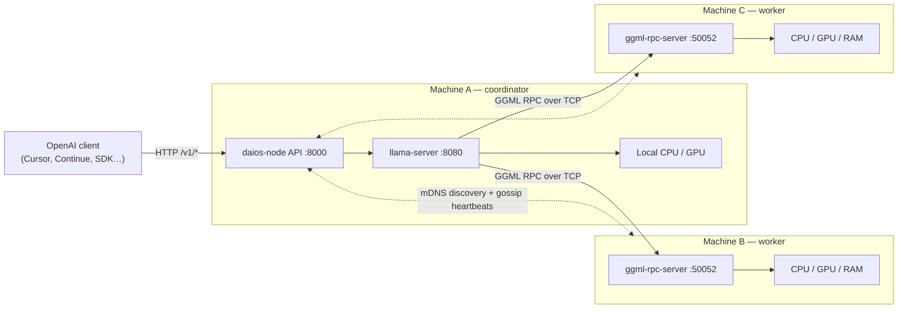

<div align="center">

# BSDK — Beyond Single Device Kernel

**Pool the memory of every computer on your LAN and run one large language model across all of them —
behind a single OpenAI-compatible API.**

[](https://github.com/harshd5382-droid/BSDK/actions/workflows/ci.yml)
[](LICENSE)


[Quick start](#quick-start) · [How it works](#how-it-works) · [Configuration](#configuration) ·
[API](#api-reference) · [Docs](#documentation) · [Contributing](CONTRIBUTING.md)

</div>

---

## Why BSDK?

Most people have more total memory spread across their machines than any single machine holds. A 70B model
won't fit on a 16 GB laptop, but it might fit across a laptop, a desktop and an old gaming PC.

BSDK is a peer-to-peer **distributed AI operating system** prototype that makes that pool usable:

- Every machine runs the **same `daios-node` software**. A machine's role (`coordinator`, `worker` or
  `hybrid`) is **set in its config**. There are no permanent master nodes.
- The coordinator runs [llama.cpp](https://github.com/ggml-org/llama.cpp)'s `llama-server` and spreads model
  layers onto workers over **GGML RPC**, so the model can be larger than any one machine's memory.
- Clients just see an **OpenAI-compatible endpoint** (`/v1/chat/completions`). That works with Continue, Cursor,
  Open WebUI, the `openai` SDKs, and anything else that speaks the OpenAI API.
- A **one-click dashboard** and a **zero-prerequisite Windows worker installer** mean non-experts can add a
  PC to the cluster.

> **Honest expectations.** RPC pooling buys **capacity**: models that don't fit on one machine. It doesn't
> make generation faster. Every token crosses the network at each device boundary, so more machines usually
> means *slower* tokens. You only gain speed when a worker's device is much faster than what the coordinator
> would otherwise use (for example a worker GPU instead of coordinator CPU spill). See
> [Distributed inference](distributed-ai-os/docs/distributed-inference.md) for the full breakdown.

## Features

| Area | What you get |
|---|---|
| **Distributed inference** | llama.cpp `llama-server` + `ggml-rpc-server` memory pooling across machines; an opt-in resource-aware `--tensor-split` policy (`auto`, `balanced`, `worker_preferred`, `manual`) |
| **OpenAI-compatible API** | `/v1/models`, `/v1/chat/completions`, `/v1/completions` with streaming, proxied by the coordinator |
| **Zero-config clustering (Gen 2)** | mDNS auto-discovery, gossip membership with heartbeats and failure detection, resource advertisements, per-request coordinator leases |
| **Manual clustering (Gen 1)** | Static peer lists in YAML for networks where multicast is blocked |
| **Resilience** | Supervised subprocesses, safe debounced restarts when topology changes, bounded retry while a dropped worker is evicted |
| **Observability** | `/health`, `/metrics` (JSON) and `/metrics/prometheus` (request count, failures, latency, tokens/s, uptime) |
| **Control plane** | `daios-launcher` + React dashboard: start/stop nodes, download GGUF models from Hugging Face, manage remote workers, pause/resume workers, built-in chat |
| **Windows worker installer** | `daios-worker.exe`: a self-contained installer that needs no Python or Git and auto-starts at login, with SHA-256-verified binaries and atomic self-update |
| **Mock backend** | A full cluster with synthetic completions, so you can develop and test without llama.cpp or a GPU |
| **Security** | LAN cluster token for launcher control, optional API bearer token, optional dev mTLS between nodes |

## How it works



1. **Workers** run only `ggml-rpc-server`. They expose their CPU, GPU and RAM as remote devices and never load
   the model themselves.
2. The **coordinator** finds workers (from its static YAML in Gen 1, or by mDNS in Gen 2), waits until their
   RPC ports are ready, then launches `llama-server --rpc host1:50052,host2:50052,…`.
3. llama.cpp places layers (and their KV cache) across the local and remote devices. Optionally, the
   coordinator first probes devices and computes a `--tensor-split` from measured free memory.
4. Requests to the coordinator's `/v1/*` are proxied to `llama-server`. Tokenization, sampling and output
   stay on the coordinator.
5. If a worker drops, membership marks it dead and the coordinator restarts `llama-server` on the remaining
   nodes after a debounce window.

### Project generations

| Generation | Scope | Status |
|---|---|---|
| **Gen 1** | Manual two-node pooling, OpenAI API, health and cluster status, benchmarks | ✅ Implemented and validated |
| **Gen 2** | mDNS discovery, gossip membership, ephemeral coordinators, dashboard, Windows installer | ✅ Implemented |
| **Gen 3–5** | Custom scheduler, WAN/libp2p, native distributed inference, plugins | 📐 Specified (see [Phase 2 spec](distributed-ai-os/docs/phase-2-engineering-specification.md)) |

## Quick start

### Prerequisites

- **Python 3.11+**
- **Node.js 20+** (only to build the dashboard)
- For real inference: llama.cpp binaries built with `-DGGML_RPC=ON` (helper scripts are included) and a
  GGUF model

All commands run from the [`distributed-ai-os/`](distributed-ai-os/) directory.

### 1. Try it in 2 minutes (mock mode, no llama.cpp needed)

**Linux / macOS**

```bash
git clone https://github.com/harshd5382-droid/BSDK.git
cd BSDK/distributed-ai-os
make install          # creates .venv and installs the three packages + dev tools
make run-mock         # starts a mock worker + coordinator
```

**Windows (PowerShell)**

```powershell
git clone https://github.com/harshd5382-droid/BSDK.git
cd BSDK\distributed-ai-os
.\scripts\windows\install-dev.ps1
.venv\Scripts\daios-node.exe -c examples\two-node\worker-mock.yaml       # terminal 1
.venv\Scripts\daios-node.exe -c examples\two-node\coordinator-mock.yaml  # terminal 2
```

Then talk to it like any OpenAI server:

```bash
curl -s http://127.0.0.1:8000/v1/chat/completions \
  -H "Content-Type: application/json" \
  -d '{"model":"daios-mock-7b","messages":[{"role":"user","content":"Hello"}]}'
```

### 2. One-click dashboard

```bash
make dashboard                           # Linux / macOS
.\scripts\windows\run-dashboard.ps1      # Windows
```

This opens `http://127.0.0.1:8090`. On each PC, choose **Help another PC** (worker) or **Run the AI here**
(coordinator), turn on **Auto Discovery**, and press **Start**. The coordinator's **Models** tab downloads
GGUF files straight from Hugging Face.

### 3. Real two-machine cluster

```bash
# On both machines: build llama.cpp with RPC support
./scripts/build-llama-cpp.sh             # Windows: .\scripts\windows\build-llama-cpp.ps1

# Machine B (worker)
.venv/bin/daios-node -c examples/two-node/worker.yaml

# Machine A (coordinator): set inference.model_path and the worker's IP first
.venv/bin/daios-node -c examples/two-node/coordinator.yaml
```

Point your tools at `http://<coordinator-ip>:8000/v1`. For example, with the Python `openai` SDK:

```python
from openai import OpenAI

client = OpenAI(base_url="http://192.168.1.10:8000/v1", api_key="not-needed")
reply = client.chat.completions.create(
    model="local",
    messages=[{"role": "user", "content": "Explain GGML RPC in one sentence."}],
)
print(reply.choices[0].message.content)
```

### Windows worker in one double-click

Want to add a Windows PC that has no developer tools? Build (or download from
[Releases](https://github.com/harshd5382-droid/BSDK/releases)) `daios-worker.exe`, double-click it, and pass the
coordinator's cluster token:

```powershell
daios-worker.exe --token <CLUSTER_TOKEN>
```

It runs a system check, installs per user under `%LOCALAPPDATA%\BSDK`, registers an auto-start task, and joins
the cluster by discovery. See [Windows worker install](distributed-ai-os/docs/worker-install-windows.md).

## Configuration

Each node is configured by one YAML file, loaded into `NodeConfig`
([`config.py`](distributed-ai-os/packages/protocol/src/daios_protocol/config.py)). A Gen 2 coordinator with
discovery and resource-aware placement:

```yaml
node_id: coordinator-a
role: coordinator            # coordinator | worker | hybrid
network:
  bind_host: 0.0.0.0
  api_port: 8000
  rpc_port: 50052
discovery:
  enabled: true              # false = Gen 1 static peers[]
  mdns: true
  cluster_name: daios-home
inference:
  backend: llama.cpp         # or "mock"
  model_path: models/qwen2.5-7b-instruct-q4_k_m.gguf
  llama_server_port: 8080
  distribution:              # optional; omit to use llama.cpp's default split
    policy: auto             # auto | balanced | worker_preferred | manual
    coordinator_reserve_ram_gb: 4.0
    worker_reserve_ram_gb: 2.0
```

Ready-made examples:

- [`examples/two-node/`](distributed-ai-os/examples/two-node/): Gen 1 static peers (`*-mock.yaml`,
  `*-local.yaml` loopback, and real cross-machine configs)
- [`examples/two-node-discovered/`](distributed-ai-os/examples/two-node-discovered/): Gen 2 mDNS discovery

Useful environment variables:

| Variable | Purpose |
|---|---|
| `DAIOS_LOG_DIR` | Where `llama-server` / `ggml-rpc-server` logs are written |
| `DAIOS_CLUSTER_TOKEN` | Cluster token for launcher and worker control |
| `DAIOS_PROXY_RETRIES` / `DAIOS_PROXY_RETRY_BACKOFF` | Retry budget for transient proxy failures (default `1` / `0.5`s) |
| `LD_LIBRARY_PATH` | Must include the bundled llama.cpp libraries for real runs on Linux |

### Ports

| Port | Protocol | Used by |
|---|---|---|
| `8000` | TCP | Node API and OpenAI proxy (`network.api_port`) |
| `8080` | TCP | Local `llama-server` (coordinator, loopback) |
| `50052` | TCP | `ggml-rpc-server` (workers) |
| `8090` | TCP | Launcher API and dashboard |
| `5353` | UDP | mDNS discovery (Gen 2) |

## API reference

**Node (`daios-node`, default `:8000`)**

| Endpoint | Description |
|---|---|
| `GET /health` | Node health, inference process state, resources |
| `GET /metrics` | JSON metrics: generation, peers, leases, request stats |
| `GET /metrics/prometheus` | Prometheus text exposition |
| `GET /api/v1/cluster` | Peers or membership view and RPC endpoints |
| `GET /api/v1/membership` | Gen 2 membership (discovery only) |
| `GET /api/v1/distribution` | Current device placement and tensor split |
| `POST /api/v1/inference/reload` | Restart inference with the current topology |
| `GET/POST /api/v1/workers/{paused,pause,resume}` | Exclude workers from placement or bring them back |
| `GET /v1/models`, `POST /v1/chat/completions`, `POST /v1/completions` | OpenAI-compatible inference (coordinator) |

**Launcher (`daios-launcher`, default `:8090`)** serves the dashboard and exposes `/api/launcher/*` for
start/stop, model download and selection, remote worker control, autostart, logs and chat.

## Security model

BSDK is built for **trusted local networks**.

- The **cluster token** (`X-DAIOS-Token`) is a LAN shared secret. Anyone on the network who has it can
  control worker launchers. Treat it like a password.
- GGML RPC has **no authentication or encryption**. Never expose port `50052` to the internet.
- Optional hardening: an API bearer token for the OpenAI endpoint, and dev mTLS between nodes.

See [SECURITY.md](SECURITY.md) for the threat model and how to report vulnerabilities.

## Repository layout

```
BSDK/
├── distributed-ai-os/          # the working codebase (run commands from here)
│   ├── packages/protocol/      # daios_protocol: NodeConfig, health models, gossip messages
│   ├── apps/node/              # daios_node: FastAPI peer daemon (inference, membership, proxy)
│   ├── apps/launcher/          # daios_launcher: control plane, model manager, Windows installer
│   ├── apps/dashboard/         # React 19 + Vite 6 + Tailwind v4 UI
│   ├── examples/               # canonical node YAML configs
│   ├── benchmarks/             # latency / throughput / oversized-model benchmarks
│   ├── deploy/docker/          # Dockerfile + mock cluster compose
│   ├── packaging/windows/      # PyInstaller spec + binary manifest for daios-worker.exe
│   ├── scripts/                # install, build, run helpers (bash + PowerShell)
│   ├── tests/                  # 200+ unit and integration tests
│   └── docs/                   # architecture, operations, troubleshooting, specs
├── goal/                       # long-term phase goals (reference only)
└── .github/                    # CI, issue and PR templates
```

## Development

```bash
make install     # dev environment
make test        # pytest (asyncio auto mode)
make lint        # ruff, line length 100, py311
make benchmark   # against a running coordinator

# dashboard with hot reload
.venv/bin/daios-launcher --root .        # terminal 1
cd apps/dashboard && npm run dev         # terminal 2
```

On Windows, run tests and lint through the venv:

```powershell
.venv\Scripts\python.exe -m pytest tests\ -q
.venv\Scripts\python.exe -m ruff check packages\ apps\node apps\launcher tests\ benchmarks\
```

CI ([`.github/workflows/ci.yml`](.github/workflows/ci.yml)) runs lint and tests on Ubuntu and Windows and builds
the dashboard on every push and pull request.

## Documentation

| Doc | What's inside |
|---|---|
| [Detailed setup guide](distributed-ai-os/README.md) | Every run mode, the Windows installer, maintainer build steps |
| [Distributed inference](distributed-ai-os/docs/distributed-inference.md) | What GGML RPC really distributes, placement policies, validation |
| [Gen 1 architecture](distributed-ai-os/docs/architecture-gen1.md) / [Gen 2 architecture](distributed-ai-os/docs/architecture-gen2.md) | Components and sequence diagrams |
| [Operations guide](distributed-ai-os/docs/operations-guide.md) | Install, ports, logs, upgrade and rollback |
| [Troubleshooting](distributed-ai-os/docs/troubleshooting-guide.md) | Common failures and fixes |
| [Phase 2 engineering spec](distributed-ai-os/docs/phase-2-engineering-specification.md) | Roadmap for Gen 3–5 |

## Contributing

Contributions are welcome: bug reports, docs, tests, benchmarks on new hardware, and features. Please read
[CONTRIBUTING.md](CONTRIBUTING.md) and the [Code of Conduct](CODE_OF_CONDUCT.md) before opening a pull request.
Benchmark results from real multi-machine setups are especially valuable.

## Acknowledgements

BSDK stands on the shoulders of [llama.cpp / ggml](https://github.com/ggml-org/llama.cpp) (GGUF inference and
the RPC backend), [FastAPI](https://fastapi.tiangolo.com/), [Uvicorn](https://www.uvicorn.org/),
[HTTPX](https://www.python-httpx.org/), [python-zeroconf](https://github.com/python-zeroconf/python-zeroconf),
[psutil](https://github.com/giampaolo/psutil), [React](https://react.dev/), [Vite](https://vite.dev/) and
[Tailwind CSS](https://tailwindcss.com/).

## License

BSDK is released under the [MIT License](LICENSE). Third-party components (such as llama.cpp binaries bundled
into the Windows installer) remain under their own licenses.
