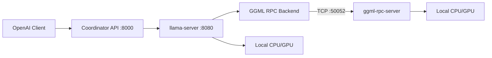
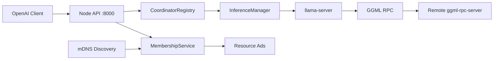

# Distributed AI OS

Peer-to-Peer Distributed AI Operating System — Generation 1 prototype validated; **Generation 2** adds automatic LAN discovery, gossip membership, and ephemeral per-request coordinators.

## Generation 1 Goals (Complete)

- Two-node distributed inference (memory pooling across machines)
- llama.cpp + `ggml-rpc-server` integration
- OpenAI-compatible API (`/v1/chat/completions`)
- Manual node configuration (YAML)
- Peer health checks and cluster status API
- Benchmark suite and integration tests
- Coding assistant compatibility (OpenAI API clients)

## Generation 2 Features (Implemented)

- mDNS automatic peer discovery (`discovery.enabled: true`)
- Gossip membership with heartbeat and failure detection
- Resource advertisements (CPU, RAM, GPU best-effort)
- Ephemeral per-request coordinator leases
- Optional API Bearer token and dev mTLS
- Dashboard "Auto Discovery" wizard toggle
- Backward compatible — Gen 1 manual YAML still works when discovery is off

## Repository Layout

```
distributed-ai-os/
  apps/node/          Node daemon (daios-node)
  apps/launcher/      One-click launcher + control API
  apps/dashboard/     React wizard UI
  packages/protocol/  Shared config and health types
  examples/two-node/           Coordinator + worker YAML (Gen 1 manual)
  examples/two-node-discovered/  mDNS discovery configs (Gen 2)
  deploy/docker/      Docker Compose for mock cluster
  benchmarks/         Latency/throughput benchmarks
  scripts/            Build and dev helpers
  tests/              Unit and integration tests
  docs/               Architecture and setup guides
```

## Dashboard (One-Click UI)

The easiest way to start — open a browser, pick your role, enter the other PC's IP, click Start.

**Linux / macOS:**

```bash
cd distributed-ai-os
chmod +x scripts/run-dashboard.sh
make dashboard
```

**Windows (PowerShell — no `make`/`bash` needed):**

```powershell
cd distributed-ai-os
.\scripts\windows\run-dashboard.ps1
```

Both build the React dashboard and open `http://127.0.0.1:8090`. On Windows,
`scripts\windows\install-dev.ps1` sets up the `.venv` (mirrors `make install`).
The steps below say `make dashboard`; on Windows substitute `.\scripts\windows\run-dashboard.ps1`.

**Two PCs over LAN (manual peer IP):**
1. On **PC B** (worker): run `make dashboard` → choose **Help another PC** → **Start Worker** → share the displayed IP (`192.168.x.x:50052`).
2. On **PC A** (coordinator): run `make dashboard` → choose **Run the AI here** → enter PC B's IP → **Connect and Start**.

**Two PCs over LAN (auto discovery — Gen 2):**
1. On both PCs: run `make dashboard` → enable **Auto Discovery** when starting worker or coordinator.
2. Nodes join the same mDNS cluster (`cluster_name: daios`) without entering peer IPs.

Development mode (Vite hot reload + launcher API):

```bash
# Terminal 1
.venv/bin/daios-launcher --root .

# Terminal 2
cd apps/dashboard && npm run dev
```

## Quick Start (Mock Mode — No llama.cpp Required)

For terminal-only testing without the dashboard:

```bash
cd distributed-ai-os
./scripts/install-dev.sh

# Terminal 1 — worker
daios-node -c examples/two-node/worker-mock.yaml

# Terminal 2 — coordinator
daios-node -c examples/two-node/coordinator-mock.yaml

# Test OpenAI-compatible inference
curl -s http://127.0.0.1:8000/v1/chat/completions \
  -H "Content-Type: application/json" \
  -d '{"model":"daios-mock-7b","messages":[{"role":"user","content":"Hello"}]}'
```

Or use the helper script:

```bash
./scripts/run-mock-cluster.sh
```

## Generation 2 Discovery (Mock Mode)

```bash
# Terminal 1 — worker with mDNS
daios-node -c examples/two-node-discovered/worker-mdns.yaml

# Terminal 2 — coordinator with mDNS (discovers worker automatically)
daios-node -c examples/two-node-discovered/coordinator-mdns.yaml

# Check membership
curl -s http://127.0.0.1:8000/api/v1/membership | jq .
curl -s http://127.0.0.1:8000/api/v1/cluster | jq .generation
```

Install mDNS support: `pip install zeroconf` (included in `make install`).

## Two-Node Production Path (llama.cpp + GGML RPC)

### 1. Build llama.cpp with RPC support

```bash
./scripts/build-llama-cpp.sh
```

This installs `llama-server` and `ggml-rpc-server` with `-DGGML_RPC=ON`.

### 2. Start worker node

On **Machine B** (worker):

```bash
daios-node -c examples/two-node/worker.yaml
```

This starts `ggml-rpc-server` on port `50052`, exposing local CPU/GPU devices.

### 3. Start coordinator node

On **Machine A** (coordinator), set `inference.model_path` and peer host in `coordinator.yaml`:

```bash
daios-node -c examples/two-node/coordinator.yaml
```

The coordinator runs `llama-server` with `--rpc worker:50052`, pooling memory across both nodes. The node API proxies OpenAI requests to llama-server.

### Validated single-machine real run (loopback two-node)

A real llama.cpp run was validated on one CPU-only host using loopback RPC
(coordinator + one worker on `127.0.0.1`). This exercises the same TCP/serialization
code path as a cross-machine deployment. See
[`benchmarks/results/gen1-validation-report.md`](benchmarks/results/gen1-validation-report.md).

```bash
# Build llama.cpp (cmake/ninja via uv, no sudo needed):
~/.local/bin/uv pip install --python .venv/bin/python cmake ninja
git clone --depth 1 https://github.com/ggml-org/llama.cpp.git /tmp/llama.cpp-src
PATH="$PWD/.venv/bin:$PATH" cmake -S /tmp/llama.cpp-src -B /tmp/llama.cpp-src/build \
  -G Ninja -DCMAKE_BUILD_TYPE=Release -DGGML_RPC=ON -DLLAMA_CURL=OFF \
  -DLLAMA_BUILD_TESTS=OFF -DLLAMA_BUILD_EXAMPLES=OFF
PATH="$PWD/.venv/bin:$PATH" cmake --build /tmp/llama.cpp-src/build -j4 \
  --target llama-server ggml-rpc-server
cp /tmp/llama.cpp-src/build/bin/{llama-server,ggml-rpc-server,lib*.so*} .venv/bin/

# Download a small GGUF model into models/
mkdir -p models && curl -L -o models/qwen2.5-0.5b-instruct-q4_k_m.gguf \
  "https://huggingface.co/Qwen/Qwen2.5-0.5B-Instruct-GGUF/resolve/main/qwen2.5-0.5b-instruct-q4_k_m.gguf?download=true"

# Run worker then coordinator. LD_LIBRARY_PATH points at the bundled llama.cpp libs;
# DAIOS_LOG_DIR is where inference subprocess logs are written.
export LD_LIBRARY_PATH="$PWD/.venv/bin" DAIOS_LOG_DIR="$PWD/logs"
.venv/bin/daios-node -c examples/two-node/worker-local.yaml &
.venv/bin/daios-node -c examples/two-node/coordinator-local.yaml &

# Benchmark distributed vs single-node baseline:
.venv/bin/python benchmarks/run_benchmark.py --url http://127.0.0.1:8000 -n 8 \
  --label rpc-distributed -o benchmarks/results/gen1-rpc-distributed.json
```

### 4. Use with coding assistants

Point any OpenAI-compatible client at:

```
http://<coordinator-host>:8000/v1
```

Works with Continue, Cursor, Open WebUI, and other OpenAI API clients.

## API Endpoints

| Endpoint | Description |
|----------|-------------|
| `GET /health` | Node health and inference process status |
| `GET /metrics` | Operational metrics (includes `generation`) |
| `GET /api/v1/cluster` | Peer list / membership view and RPC endpoints |
| `GET /api/v1/membership` | Gen 2 membership view (when discovery enabled) |
| `GET /v1/models` | OpenAI-compatible model list |
| `POST /v1/chat/completions` | OpenAI-compatible chat inference |

## Development

```bash
make install
make test
make benchmark
```

Repository CI is defined in `../.github/workflows/ci.yml` (Ubuntu/Windows Python checks + dashboard build).

## Architecture (Generation 1)



Every node runs identical `daios-node` software. Role (`coordinator`, `worker`, `hybrid`) is configuration-only — matching the Phase 1 vision of no permanent master nodes.

## Architecture (Generation 2)



See [Generation 2 architecture](docs/architecture-gen2.md) for full sequence diagrams.

## Windows Worker (.exe) — zero-prerequisite installer

`daios-worker.exe` is a **self-contained, one-click installer**. On a fresh Windows
10/11 **x64** PC with **no Git and no Python**, a user double-clicks it and gets a real
running GGML RPC worker that auto-starts at login. Workers contribute compute (RPC
only); the **coordinator** downloads and loads GGUF models.

### Worker quick start (end user)

1. **Double-click `daios-worker.exe`.** It runs a system check (Windows version, x64,
   RAM, disk, network, ports), installs per-user under `%LOCALAPPDATA%\BSDK` (no admin
   needed), materializes a **verified** `ggml-rpc-server.exe`, starts the worker
   (role `worker`, Auto Discovery, API `8001`, RPC `50052`, launcher `8090`, bound to
   the LAN), and registers a **Task Scheduler** job (`DAIOS Worker`) to auto-start at
   login.
2. The worker is reachable at `http://<LAN-IP>:8001/health` and the control API at
   `http://<LAN-IP>:8090` (token-protected for non-localhost). It appears automatically
   through BSDK discovery on the coordinator.
3. **Running it again repairs/updates** the install (atomic; settings preserved; a
   failed update leaves the previous worker usable) — no duplicate tasks.

Detailed logs are written to `%LOCALAPPDATA%\BSDK\logs` (the cluster token is redacted).
On a failed double-click the console stays open so the error is readable.

Pair the worker with the coordinator's cluster token via any of:

```powershell
daios-worker.exe --token <CLUSTER_TOKEN>      # explicit
$env:DAIOS_CLUSTER_TOKEN = "<CLUSTER_TOKEN>"  # environment
# or omit it — the first run generates and persists a token
```

Other commands:

```powershell
daios-worker.exe --check                 # print the system report and exit
daios-worker.exe --uninstall             # stop worker + remove autostart (keeps data)
daios-worker.exe --uninstall --purge     # also delete %LOCALAPPDATA%\BSDK
daios-worker.exe --dev                   # legacy Git+venv developer install
```

Unsupported systems (non-Windows, ARM, Windows < 10) get a clear error and exit
without installing. The installer **never** falls back to the mock backend when the
real RPC binary is missing — it fails loudly with instructions.

### Build the installer (maintainer)

```powershell
cd distributed-ai-os
# (optional) build the native RPC binaries first to bundle them for offline installs:
.\scripts\windows\build-llama-cpp.ps1 -InstallDir .\packaging\windows\bin
# build the self-contained exe (bundles Python + all 3 BSDK packages + binaries-if-present):
.\scripts\windows\build-exe.ps1            # or: build-exe.ps1 -BinDir <dir-with-ggml-rpc-server.exe>
# Output: dist\daios-worker.exe
```

**Release artifacts.** If you do not bundle the native binaries at build time, the
installer downloads them at runtime and **verifies SHA-256**. Publish the
`ggml-rpc-server` Windows x64 zip and fill in its URL + checksum in
[`packaging/windows/binaries-manifest.json`](packaging/windows/binaries-manifest.json)
(replace `REPLACE_WITH_RELEASE_SHA256`). Until that is published *and* no binaries are
bundled, the installer refuses to run (it will not use an unverified or mock backend).

### Coordinator: model manager + remote workers

On the coordinator PC, use `make dashboard` and choose **Coordinator** with **Auto Discovery**.

- **Models** tab — download a GGUF (direct URL or `org/model:file.gguf`), select active model, delete old models.
- **Remote Workers** panel — start/stop/update discovered worker PCs over the LAN (requires the same cluster token).

Share the cluster token from the coordinator **system** API (`GET /api/launcher/system` → `cluster_token`) with worker installs, or set `--token <value>` when launching workers.

### Security note

The cluster token (`X-DAIOS-Token` header) is a **LAN shared secret**. Anyone on your network with the token can control worker launchers. Use only on trusted LANs; enable mTLS on nodes for stricter peer auth (Gen 2).

## Documentation

- [Phase 2 engineering specification](docs/phase-2-engineering-specification.md) — master spec and index
- [Phase 1 research & architecture strategy](docs/phase-1-research-architecture.md) — multi-generation research
- [Generation 1 architecture](docs/architecture-gen1.md) — manual peer prototype
- [Generation 2 architecture](docs/architecture-gen2.md) — discovery, membership, coordinator
- [Operations guide](docs/operations-guide.md) — install, ports, logs, upgrade/rollback
- [Troubleshooting guide](docs/troubleshooting-guide.md) — common failure diagnosis and fixes

## Research Findings

| Technology | Decision | Rationale |
|------------|----------|-----------|
| llama.cpp | **Reuse** | Mature GGUF inference, OpenAI API via llama-server |
| GGML RPC | **Reuse** | Proven memory pooling across nodes; LAN-only PoC |
| OpenAI API | **Reuse** | llama-server native + node proxy |
| Discovery | **mDNS (Gen 2)** | Auto-join on LAN; libp2p planned for WAN |
| Scheduler | **Defer to Gen 3** | Greedy placement in Gen 2; custom scheduler later |
| Native distributed inference | **Defer to Gen 4** | Replace only if benchmarking justifies |

## License

MIT
