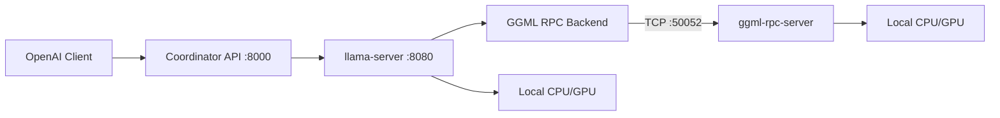

# Distributed AI OS — Generation 1 Prototype

Peer-to-Peer Distributed AI Operating System — practical two-node prototype validating distributed inference via **llama.cpp** and **GGML RPC**.

## Generation 1 Goals

- Two-node distributed inference (memory pooling across machines)
- llama.cpp + `ggml-rpc-server` integration
- OpenAI-compatible API (`/v1/chat/completions`)
- Manual node configuration (YAML)
- Peer health checks and cluster status API
- Benchmark suite and integration tests
- Coding assistant compatibility (OpenAI API clients)

## Repository Layout

```
distributed-ai-os/
  apps/node/          Node daemon (daios-node)
  apps/launcher/      One-click launcher + control API
  apps/dashboard/     React wizard UI
  packages/protocol/  Shared config and health types
  examples/two-node/  Coordinator + worker YAML configs
  deploy/docker/      Docker Compose for mock cluster
  benchmarks/         Latency/throughput benchmarks
  scripts/            Build and dev helpers
  tests/              Unit and integration tests
  docs/               Architecture and setup guides
```

## Dashboard (One-Click UI)

The easiest way to start — open a browser, pick your role, enter the other PC's IP, click Start.

```bash
cd distributed-ai-os
chmod +x scripts/run-dashboard.sh
make dashboard
```

This builds the React dashboard and opens `http://127.0.0.1:8090`.

**Two PCs over LAN:**
1. On **PC B** (worker): run `make dashboard` → choose **Help another PC** → **Start Worker** → share the displayed IP (`192.168.x.x:50052`).
2. On **PC A** (coordinator): run `make dashboard` → choose **Run the AI here** → enter PC B's IP → **Connect and Start**.

Development mode (Vite hot reload + launcher API):

```bash
# Terminal 1
.venv/bin/daios-launcher --root .

# Terminal 2
cd apps/dashboard && npm run dev
## Quick Start (Mock Mode — No llama.cpp Required)

For terminal-only testing without the dashboard:

```bash
cd distributed-ai-os
./scripts/install-dev.sh

# Terminal 1 — worker
daios-node -c examples/two-node/worker-mock.yaml

# Terminal 2 — coordinator
daios-node -c examples/two-node/coordinator-mock.yaml

# Test OpenAI-compatible inference
curl -s http://127.0.0.1:8000/v1/chat/completions \
  -H "Content-Type: application/json" \
  -d '{"model":"daios-mock-7b","messages":[{"role":"user","content":"Hello"}]}'
```

Or use the helper script:

```bash
./scripts/run-mock-cluster.sh
```

## Two-Node Production Path (llama.cpp + GGML RPC)

### 1. Build llama.cpp with RPC support

```bash
./scripts/build-llama-cpp.sh
```

This installs `llama-server` and `ggml-rpc-server` with `-DGGML_RPC=ON`.

### 2. Start worker node

On **Machine B** (worker):

```bash
daios-node -c examples/two-node/worker.yaml
```

This starts `ggml-rpc-server` on port `50052`, exposing local CPU/GPU devices.

### 3. Start coordinator node

On **Machine A** (coordinator), set `inference.model_path` and peer host in `coordinator.yaml`:

```bash
daios-node -c examples/two-node/coordinator.yaml
```

The coordinator runs `llama-server` with `--rpc worker:50052`, pooling memory across both nodes. The node API proxies OpenAI requests to llama-server.

### Validated single-machine real run (loopback two-node)

A real llama.cpp run was validated on one CPU-only host using loopback RPC
(coordinator + one worker on `127.0.0.1`). This exercises the same TCP/serialization
code path as a cross-machine deployment. See
[`benchmarks/results/gen1-validation-report.md`](benchmarks/results/gen1-validation-report.md).

```bash
# Build llama.cpp (cmake/ninja via uv, no sudo needed):
~/.local/bin/uv pip install --python .venv/bin/python cmake ninja
git clone --depth 1 https://github.com/ggml-org/llama.cpp.git /tmp/llama.cpp-src
PATH="$PWD/.venv/bin:$PATH" cmake -S /tmp/llama.cpp-src -B /tmp/llama.cpp-src/build \
  -G Ninja -DCMAKE_BUILD_TYPE=Release -DGGML_RPC=ON -DLLAMA_CURL=OFF \
  -DLLAMA_BUILD_TESTS=OFF -DLLAMA_BUILD_EXAMPLES=OFF
PATH="$PWD/.venv/bin:$PATH" cmake --build /tmp/llama.cpp-src/build -j4 \
  --target llama-server ggml-rpc-server
cp /tmp/llama.cpp-src/build/bin/{llama-server,ggml-rpc-server,lib*.so*} .venv/bin/

# Download a small GGUF model into models/
mkdir -p models && curl -L -o models/qwen2.5-0.5b-instruct-q4_k_m.gguf \
  "https://huggingface.co/Qwen/Qwen2.5-0.5B-Instruct-GGUF/resolve/main/qwen2.5-0.5b-instruct-q4_k_m.gguf?download=true"

# Run worker then coordinator. LD_LIBRARY_PATH points at the bundled llama.cpp libs;
# DAIOS_LOG_DIR is where inference subprocess logs are written.
export LD_LIBRARY_PATH="$PWD/.venv/bin" DAIOS_LOG_DIR="$PWD/logs"
.venv/bin/daios-node -c examples/two-node/worker-local.yaml &
.venv/bin/daios-node -c examples/two-node/coordinator-local.yaml &

# Benchmark distributed vs single-node baseline:
.venv/bin/python benchmarks/run_benchmark.py --url http://127.0.0.1:8000 -n 8 \
  --label rpc-distributed -o benchmarks/results/gen1-rpc-distributed.json
```

### 4. Use with coding assistants

Point any OpenAI-compatible client at:

```
http://<coordinator-host>:8000/v1
```

Works with Continue, Cursor, Open WebUI, and other OpenAI API clients.

## API Endpoints

| Endpoint | Description |
|----------|-------------|
| `GET /health` | Node health and inference process status |
| `GET /metrics` | Basic operational metrics |
| `GET /api/v1/cluster` | Peer list and RPC endpoints |
| `GET /v1/models` | OpenAI-compatible model list |
| `POST /v1/chat/completions` | OpenAI-compatible chat inference |

## Development

```bash
make install
make test
make benchmark
```

## Architecture (Generation 1)



Every node runs identical `daios-node` software. Role (`coordinator`, `worker`, `hybrid`) is configuration-only — matching the Phase 1 vision of no permanent master nodes.

## Documentation

- [Phase 1 research & architecture strategy](docs/phase-1-research-architecture.md) — full multi-generation research document
- [Generation 1 architecture](docs/architecture-gen1.md) — implementation reference for the current prototype

## Research Findings

| Technology | Generation 1 Decision | Rationale |
|------------|----------------------|-----------|
| llama.cpp | **Reuse** | Mature GGUF inference, OpenAI API via llama-server |
| GGML RPC | **Reuse** | Proven memory pooling across nodes; PoC stage, LAN-only |
| OpenAI API | **Reuse** | llama-server native + node proxy |
| Discovery | **Defer to Gen 2** | Manual YAML peer config for prototype |
| Scheduler | **Defer to Gen 3** | llama.cpp tensor-split for Gen 1 |
| Native distributed inference | **Defer to Gen 4** | Replace only if benchmarking justifies |

## License

MIT
