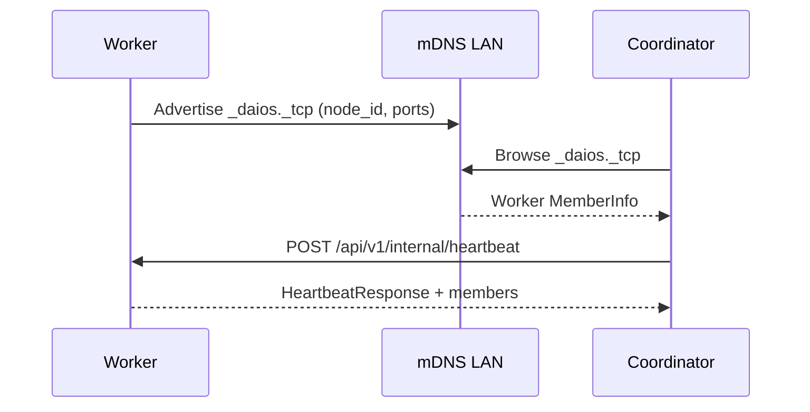
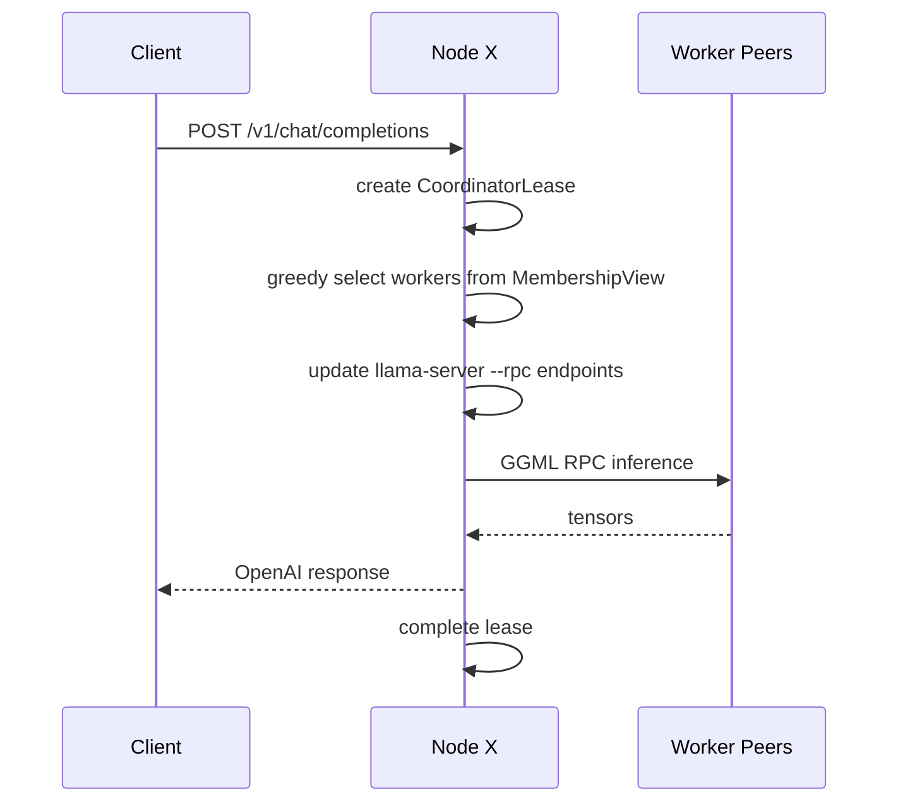

# Generation 2 Architecture

**Status:** Implemented (2026-06-30)  
**Repository:** `distributed-ai-os/`  
**Prerequisite:** [Generation 1 Architecture](architecture-gen1.md)

---

## Overview

Generation 2 replaces manual peer YAML with **automatic LAN discovery**, **gossip membership**, **resource advertisements**, and **ephemeral per-request coordinators** while keeping llama.cpp + GGML RPC as the inference backend.

Public APIs remain backward compatible: `/v1/*`, `/health`, `/api/v1/cluster`. New behavior is opt-in via `discovery.enabled: true`.

---

## Components

| Module | Path | Purpose |
|--------|------|---------|
| Discovery | `apps/node/src/daios_node/discovery.py` | mDNS advertise/listen (`_daios._tcp.local.`) |
| Membership | `apps/node/src/daios_node/membership.py` | Heartbeat gossip, failure detection, leave |
| Resources | `apps/node/src/daios_node/resources.py` | CPU/RAM/GPU ads, greedy placement scoring |
| Coordinator | `apps/node/src/daios_node/coordinator.py` | Per-request leases, worker selection |
| Security | `apps/node/src/daios_node/security.py` | Optional mTLS + API Bearer token |
| Protocol | `packages/protocol/` | `DiscoveryConfig`, `MembershipView`, wire messages |

---

## Node Roles (unchanged binary)

Same `daios-node` binary; role from YAML. In Gen 2, **any node can coordinate a request** it receives — role defaults behavior at idle.

---

## Discovery Flow



---

## Request Coordination Flow



---

## Configuration

```yaml
node_id: worker-mdns
role: worker
discovery:
  enabled: true
  mdns: true
  cluster_name: daios-home
membership:
  heartbeat_interval: 5.0
  failure_timeout: 15.0
security:
  mtls_enabled: false
  api_token: null
```

When `discovery.enabled: false` (default), node behaves exactly as Generation 1.

---

## API Additions

| Endpoint | Method | Description |
|----------|--------|-------------|
| `/api/v1/membership` | GET | Full `MembershipView` (Gen 2 only) |
| `/api/v1/internal/heartbeat` | POST | Peer gossip heartbeat |
| `/api/v1/internal/leave` | POST | Graceful leave |

`/api/v1/cluster` returns `generation: 2` and embeds `membership` when discovery is active.

---

## Dashboard

- **Auto Discovery** toggle in coordinator/worker wizard
- `TopologyGraph` renders multi-member cluster when `membership` present
- Active coordinator leases shown in topology panel

---

## Dependencies

```bash
pip install 'daios-node[discovery]'   # zeroconf for mDNS
pip install 'daios-node[security]'    # cryptography for dev mTLS certs
```

---

## Validation

- 63 tests passing (Gen 1 + Gen 2)
- Examples: `examples/two-node-discovered/*.yaml`
- Mock integration: `tests/test_membership_integration.py`

---

## Known Limitations (Gen 2)

- mDNS LAN-only; libp2p WAN deferred to Gen 2.1
- llama-server restarted when RPC peer set changes (brief interruption)
- No multi-user fairness (Gen 3)
- Dev mTLS certs are self-signed only

---

## Related Documents

| Document | Purpose |
|----------|---------|
| [phase-2-engineering-specification.md](phase-2-engineering-specification.md) | Full Phase 2 spec index |
| [architecture-gen1.md](architecture-gen1.md) | Generation 1 baseline |
| [phase-1-research-architecture.md](phase-1-research-architecture.md) | Research foundation |
