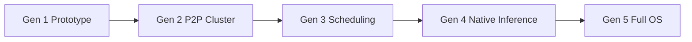
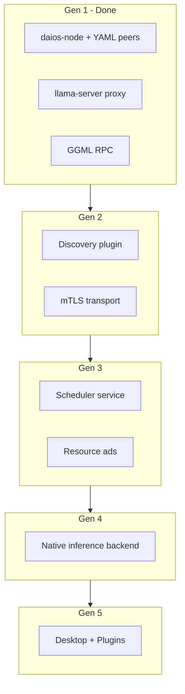

# Phase 1 — Engineering Research & Architecture Strategy

**Peer-to-Peer Distributed AI Operating System**

Status: **Complete** (2026-06-29)  
Repository: `distributed-ai-os/`  
Generation 1 prototype: **Validated** — see [`architecture-gen1.md`](architecture-gen1.md) and [`benchmarks/results/gen1-validation-report.md`](../benchmarks/results/gen1-validation-report.md).

---

## Executive Summary

This document defines the architectural foundation for a multi-year open-source **Peer-to-Peer Distributed AI Operating System (DAIOS)**. The platform lets independent computers on LAN, VPN, or (eventually) the public internet behave as one AI compute fabric while remaining easy to install, fault tolerant, and cross-platform.

**Phase 1 conclusion:** Do not build a new inference engine on day one. **Reuse llama.cpp + GGML RPC** for Generation 1 to prove distributed inference with minimal code. Evolve through five generations toward a native distributed AI operating system. Generation 1 has been validated end-to-end: two-node loopback RPC inference, OpenAI-compatible API, `daios-node` orchestration, 14/14 tests green.

**Key architectural bets:**

| Bet | Rationale |
|-----|-----------|
| Identical software on every node | Eliminates permanent master/worker split; roles are configuration-only |
| Ephemeral request coordinators | Any node can coordinate its own request; no permanent control plane |
| Stable OpenAI `/v1/*` API | Clients (coding assistants, dashboards) survive generational backend changes |
| Generational evolution | Reuse → extend → replace per subsystem; avoid big-bang rewrites |
| Native distributed inference only when justified | Gen 1 benchmarks show ~5% RPC overhead for small models; build Gen 4 engine only if benchmarking predicts measurable gains |

---

## Architectural Vision

### Core principles

1. **Symmetric nodes** — Every machine runs the same `daios-node` binary. A node may simultaneously be client, worker, resource provider, request coordinator, API host, and scheduler participant depending on configuration and active requests.

2. **No permanent control plane** — There is no always-on master. When a user submits a request from any machine, that machine temporarily becomes the **Request Coordinator**. The coordinator may also contribute local CPU/RAM/GPU. When the request completes, coordinator responsibilities end automatically.

3. **Composable reuse** — Mature OSS (llama.cpp, GGML, libp2p candidates) accelerates early generations. Replacement is scoped per subsystem with stable public interfaces.

4. **Memory-first distribution in Gen 1** — GGML RPC pools device memory across nodes so clusters can run models larger than any single node's RAM. Compute parallelism and latency optimization are later-generation concerns.

### Target end state (Generation 5)

A complete distributed AI operating system with:

- Automatic scaling and peer discovery
- Adaptive scheduling and resource contribution
- Native distributed inference (if benchmarks justify)
- Plugin ecosystem, desktop app, SDKs
- Cloud federation, enterprise deployment, edge computing
- Optional contributed-compute marketplace

### What Generation 1 is not

Generation 1 is a **proof-of-concept**, not the final OS. It uses manual peer YAML, no TLS, llama.cpp's default scheduler, and GGML RPC (LAN/VPN only, insecure on open internet).

---

## Evolution Strategy

Five generations, each building on stable interfaces from the prior generation.



| Generation | Objective | Inference | Discovery | Scheduler | Security |
|------------|-----------|-----------|-----------|-----------|----------|
| **1 — Prototype** | Prove two-node inference | Reuse llama.cpp + GGML RPC | Manual YAML | llama.cpp default | None |
| **2 — P2P Cluster** | Auto join, membership, recovery | Still llama.cpp | libp2p or mDNS | Basic coordinator election | TLS/mTLS |
| **3 — Scheduling** | Fairness, multi-user, admission control | llama.cpp + custom placement | Dynamic membership | Custom scheduler | AuthN/Z, quotas |
| **4 — Native Inference** | Lower sync overhead, tensor routing | Replace if benchmark wins | Same as Gen 3 | Latency-aware | Same as Gen 3 |
| **5 — Full OS** | Desktop, plugins, marketplace | Native + plugins | Federated | Global fair-share | Enterprise policies |

**Migration rule:** Public APIs (`/v1/*`, `NodeConfig` YAML core fields, `GET /health`, `GET /api/v1/cluster`) remain backward compatible. New fields and endpoints are additive.

---

## Build vs Buy Analysis

| Component | Reuse | Extend | Replace Later | Build from Scratch | Reason |
|-----------|:-----:|:------:|:-------------:|:------------------:|--------|
| **Discovery** | | ✓ (Gen 2) | | | Manual YAML sufficient for Gen 1; libp2p/mDNS in Gen 2 |
| **Scheduler** | ✓ (Gen 1) | ✓ (Gen 3) | ✓ (Gen 4+) | | llama.cpp tensor split proves concept; custom scheduler when multi-user fairness needed |
| **Networking** | ✓ TCP/HTTP | ✓ (Gen 2) | | | GGML RPC + HTTP for Gen 1; QUIC/gRPC overlay optional in Gen 2+ |
| **Resource Manager** | | ✓ (Gen 2–3) | | ✓ (algorithms) | Advertisement protocol and contribution algorithms are novel; reuse OS metrics APIs |
| **Model Loader** | ✓ llama.cpp | ✓ | ✓ (Gen 4) | | GGUF via llama.cpp today; distributed loader later |
| **API Gateway** | ✓ llama-server API | ✓ thin proxy | | | `daios-node` proxy preserves stable `/v1` for clients |
| **Inference Engine** | ✓ llama.cpp | | ✓ (Gen 4) | | Validated; native engine only if benchmarks justify |
| **Distributed Backend** | ✓ GGML RPC | | ✓ (Gen 4) | | Memory pooling proven; PoC security limits |
| **Storage** | ✓ local FS | ✓ (Gen 3) | | | Shared model cache / artifact store in later gens |
| **Dashboard** | | | ✓ | ✓ (Gen 2+) | Not required for Gen 1 validation |
| **Desktop Application** | | | ✓ | ✓ (Gen 5) | Electron/Tauri shell after core stable |
| **SDKs** | | ✓ OpenAI clients | | ✓ (Gen 3+) | OpenAI API is de facto SDK for Gen 1 |
| **Plugin System** | | | ✓ | ✓ (Gen 5) | WASM/gRPC plugin host after inference ABI stable |
| **Security** | | ✓ (Gen 2) | | ✓ (policies) | Gen 1 LAN-trusted; mTLS + identity in Gen 2 |

---

## Technology Evaluation

### Inference frameworks

| Technology | Architecture | Production readiness | CPU | Heterogeneous HW | OpenAI API | Scheduling | Networking | Scale | License | Verdict for DAIOS |
|------------|--------------|---------------------|-----|------------------|------------|------------|------------|-------|---------|-------------------|
| **llama.cpp** | Single-process + optional RPC backends | High | Excellent | CPU/GPU/Metal | Via llama-server | Basic tensor split | GGML RPC (PoC) | Single host + few RPC peers | MIT | **Reuse Gen 1–3** |
| **GGML RPC** | RPC tensor backend | PoC | Yes | Yes | N/A | llama.cpp internal | TCP | 2–few nodes | MIT | **Reuse Gen 1**; replace Gen 4 if needed |
| **prima.cpp** | llama.cpp fork/variant | Medium | Yes | GPU focus | Partial | Similar | Limited | Small | MIT | Watch; not primary |
| **distributed-llama** | Distributed llama | Medium | Yes | CPU clusters | No | Custom | Custom | Medium | MIT | Concepts for Gen 4 |
| **vLLM** | Server GPU batching | High | Limited | NVIDIA | Yes | Continuous batching | Single-node | Large single-node | Apache 2.0 | Worker node backend candidate later |
| **SGLang** | Structured generation server | High | GPU | NVIDIA | Yes | RadixAttention | Single-node | Large | Apache 2.0 | Optional backend plugin Gen 5 |
| **DeepSpeed** | Training/inference | High | Yes | Multi-GPU | No | ZeRO | NCCL | Training scale | Apache 2.0 | Not inference-first for P2P |
| **PyTorch Distributed** | Framework | High | Yes | Yes | No | Manual | NCCL/gloo | Cluster | BSD | Too heavy for edge P2P nodes |

**Gen 1 decision:** llama.cpp + GGML RPC. Validated: 13.1 tok/s single-node vs 12.4 tok/s RPC loopback (~5% overhead) for Qwen2.5-0.5B on CPU.

### Distributed systems

| Technology | Fit for DAIOS | Notes |
|------------|---------------|-------|
| **libp2p** | Gen 2 discovery + transport candidate | NAT traversal, multiplexing; used by IPFS/Filecoin |
| **mDNS** | Gen 2 LAN discovery | Simple; LAN-only |
| **gRPC** | Internal control RPC Gen 2+ | Strong typing; heavier than needed for Gen 1 |
| **QUIC** | Gen 2+ WAN transport | Low-latency streams; good for tensor chunks later |
| **ZeroMQ** | Alternative messaging | Less ecosystem than gRPC for service mesh patterns |
| **Consul / Serf** | Reject as permanent CP | Violates no-permanent-control-plane principle |
| **Kubernetes** | Reject for core P2P | Centralized orchestration; optional enterprise packaging only |
| **Ray** | Reject for core | Central scheduler; opposite of symmetric P2P vision |
| **Apache Ignite** | Memory grid reference | Concepts for distributed KV cache Gen 4 |

---

## Peer-to-Peer Cluster Architecture

### Generation 1 (implemented)

```
┌─────────────────┐         ┌─────────────────┐
│  Machine A      │         │  Machine B      │
│  daios-node     │         │  daios-node     │
│  role: coord.   │         │  role: worker   │
│  ┌───────────┐  │  HTTP   │  ┌───────────┐  │
│  │ API :8000 │◄─┼─Client  │  │ RPC :50052│  │
│  └─────┬─────┘  │         │  └─────▲─────┘  │
│  ┌─────▼─────┐  │  TCP    │  ┌─────┴─────┐  │
│  │llama-srv  │──┼─RPC─────┼─►│ggml-rpc   │  │
│  │  :8080    │  │         │  │  -server  │  │
│  └───────────┘  │         │  └───────────┘  │
└─────────────────┘         └─────────────────┘
```

- **Symmetric binary:** `daios-node` on both machines; role from YAML (`coordinator`, `worker`, `hybrid`).
- **Manual peers:** `peers[]` in config; TCP health to RPC ports; optional HTTP `/health`.
- **Cluster API:** `GET /api/v1/cluster` returns peer reachability and RPC endpoints.

### Generation 2+ (designed, not implemented)

- mDNS or libp2p for LAN/WAN discovery
- Gossip-based membership with heartbeat and graceful leave
- No single metadata leader; CRDT or lease-based ephemeral coordinator records
- Automatic reconnection when peers rejoin

---

## Dynamic Coordinator Design

### Request lifecycle

1. User submits request on **Node X** (any node with API enabled).
2. **Node X** becomes ephemeral Request Coordinator for that request ID.
3. Coordinator queries peer resource advertisements (Gen 2+) or static peer list (Gen 1).
4. Coordinator invokes inference locally and/or via RPC workers.
5. Response returns to client; coordinator state for that request is discarded.

### Multi-coordinator safety (Gen 2+)

| Concern | Mechanism |
|---------|-----------|
| Concurrent coordinators | Request-scoped IDs; no global lock; workers accept jobs tagged with coordinator ID |
| Metadata consistency | Eventually consistent gossip; no strong consensus required for inference |
| Coordinator crash mid-request | Client timeout + retry on another node; worker cancels orphaned RPC session |
| Split brain | Gen 2: versioned peer lists; Gen 3: quorum for membership changes only |

### Consensus vs lightweight coordination

**Recommendation:** Avoid Raft/Paxos for the data plane. Use:

- **Ephemeral leases** for coordinator-scoped resources (Gen 3)
- **Gossip** for membership and resource ads (Gen 2)
- **Strong consensus only** if implementing distributed model registry or billing (Gen 5)

Gen 1 uses no election — static YAML defines which node runs `llama-server`.

---

## Resource Contribution Algorithms

### Advertised signals (Gen 2+ target)

Each node continuously publishes:

- CPU usage / available cores
- RAM total / available
- GPU model, VRAM, utilization
- Storage free space
- Network bandwidth estimate and RTT to peers
- Thermal and battery state (laptops)
- Current workload and user activity (idle detection)
- Administrator-configured contribution caps

### Placement algorithm (phased)

**Gen 1:** llama.cpp `--rpc` and tensor split across registered backends; no custom logic.

**Gen 2:** Greedy placement — assign layers to peers with sufficient free memory; prefer lower RTT.

**Gen 3:** Weighted fair scheduling:

```
score(peer) = w_mem·free_mem + w_gpu·free_vram + w_lat·(1/rtt) − w_load·cpu_util − w_user·activity_penalty
```

- Requesting node contributes by default if `score(self)` exceeds threshold (keeps latency low for small models).
- Interactive hosts apply `activity_penalty` when user is active (keyboard/mouse idle < N seconds).

**Gen 4+:** Latency-aware tensor routing; pipeline parallelism where network bandwidth allows.

---

## Distributed Scheduling Strategy

| Phase | Scheduler | Capabilities |
|-------|-----------|--------------|
| Gen 1 | llama.cpp internal | Tensor split across local + RPC devices |
| Gen 2 | Coordinator-assisted | Pick peer set per model size |
| Gen 3 | DAIOS scheduler service | Multi-user fairness, priority queues, admission control, work stealing |
| Gen 4 | Latency-aware | Async execution, pipeline stages, KV cache affinity |
| Gen 5 | Global | Cross-cluster federation, marketplace bids |

**Work stealing (Gen 3):** Idle workers pull queued token-generation batches from overloaded coordinators via signed job offers.

**Admission control (Gen 3):** Reject or queue when cluster free memory < model requirement + headroom.

---

## Networking Architecture

### Generation 1

| Layer | Protocol | Purpose |
|-------|----------|---------|
| Client → Node | HTTP/1.1 | OpenAI API, health, cluster status |
| Node → llama-server | HTTP localhost | Inference proxy |
| llama-server → worker | GGML RPC (TCP) | Tensor ops, weight shards |

**Constraints:** LAN or VPN only. No encryption. Firewall: allow RPC port between peer IPs only.

### Generation 2+

- **Discovery:** mDNS (`_daios._tcp`) on LAN; libp2p DHT on WAN
- **Control plane:** gRPC or QUIC streams between peers (membership, resource ads)
- **Data plane:** GGML RPC (Gen 2–3) → optional custom tensor protocol (Gen 4)
- **NAT:** STUN/TURN or libp2p relay for home users

---

## Security Architecture

### Generation 1 — trusted LAN

- No authentication on API or RPC
- **Risk:** Any LAN host can invoke inference or join as rogue worker
- **Mitigation:** Bind to private interfaces; firewall rules; document "never expose RPC to internet"

### Generation 2 — transport security

- mTLS between peers (auto-generated cluster CA on first join)
- API tokens for `/v1/*` (optional)
- Peer allowlists during transition from Gen 1 YAML

### Generation 3 — multi-tenant

- Per-user API keys, quotas, audit logs
- Sandboxed worker execution (cgroups / containers optional)
- Signed model artifacts

### Generation 5 — enterprise

- OIDC/SAML, policy engine, marketplace escrow
- Confidential computing options for untrusted peers (research track)

---

## Prototype Roadmap

### Prototype 1 — Two-node manual (Gen 1) ✅

| Item | Detail |
|------|--------|
| **Goals** | Prove distributed inference via GGML RPC; OpenAI API; `daios-node` orchestration |
| **Outcome** | Loopback two-node validated with real llama.cpp + Qwen2.5-0.5B |
| **Success criteria** | Coherent inference output; worker accepts RPC; `/v1/chat/completions` + streaming; tests pass |
| **Limitations** | Manual YAML; no TLS; small model fits single node (RPC overhead demonstrated) |
| **Next** | Prototype 2 — automatic discovery |

### Prototype 2 — Automatic discovery (Gen 2)

| Item | Detail |
|------|--------|
| **Goals** | mDNS/libp2p join without editing peer lists |
| **Success criteria** | Third node joins within 30s; coordinator sees updated peer list |
| **Limitations** | LAN only initially |

### Prototype 3 — Dynamic coordinator (Gen 2)

| Item | Detail |
|------|--------|
| **Goals** | Submit from any node; that node coordinates |
| **Success criteria** | Requests from Node B coordinated by B while A is idle worker |

### Prototype 4 — Distributed inference at scale (Gen 4)

| Item | Detail |
|------|--------|
| **Goals** | Model exceeding single-node RAM; measure throughput vs GGML RPC |
| **Success criteria** | Cluster runs 70B+ class model split across nodes; benchmark report |

### Prototype 5 — Multi-user cluster (Gen 3)

| Item | Detail |
|------|--------|
| **Goals** | 3+ simultaneous users; fair scheduling |
| **Success criteria** | No single user >2× fair share of tokens over 10 minutes |

### Prototype 6 — Production deployment (Gen 5)

| Item | Detail |
|------|--------|
| **Goals** | Installer, desktop app, monitoring, upgrade path |
| **Success criteria** | Fresh install to working cluster in <15 minutes on Win/Mac/Linux |

---

## Performance Expectations

### Generation 1 (measured)

| Configuration | Throughput | p50 latency | Notes |
|---------------|------------|-------------|-------|
| Single-node CPU | 13.1 tok/s | 4457 ms | Qwen2.5-0.5B, 64 max tokens, i3-4130 |
| RPC loopback 2-node | 12.4 tok/s | 5303 ms | ~5% overhead vs single-node |

**Interpretation:** RPC adds per-tensor network cost. Benefit appears when model weights + KV cache exceed one node's memory — not yet benchmarked in this environment.

### Generation 2–3 (expected)

- LAN RTT adds 1–5 ms per RPC op — acceptable for memory-bound large models
- Discovery gossip < 1% CPU on idle nodes

### Generation 4 (target, if built)

- 20–40% throughput improvement on multi-node compute-bound workloads via async pipeline (hypothesis; requires benchmark before commitment)

---

## Scalability Analysis

| Dimension | Gen 1 | Gen 2–3 | Gen 4–5 |
|-----------|-------|---------|---------|
| Nodes | 2–4 practical | 2–32 LAN | 100+ federated |
| Model size | Single-node RAM pooled | Same | Trillion-param sharding research |
| Concurrent users | 1 | 10–50 | 1000+ with quotas |
| Bottleneck | RPC serialization | Scheduler + network | Cross-datacenter bandwidth |

**Scaling law for Gen 1 RPC:** Throughput does not scale linearly with nodes for models that fit one machine — memory capacity scales, not speed.

---

## Failure Scenarios

| Scenario | Gen 1 behavior | Gen 2+ mitigation |
|----------|--------------|-------------------|
| Worker crash mid-inference | Request fails; no failover | Retry on alternate worker; partial checkpoint Gen 4 |
| Coordinator crash | Client disconnects | Client resubmits to any node |
| Network partition | Stale peer list | Gossip detects unreachable; stop routing to partition |
| Rogue peer | Can serve bad tensors | mTLS + attestation Gen 3 |
| Model file missing | llama-server error at load | Distributed model registry Gen 3 |
| Out of memory | Process OOM | Admission control; smaller batch |

---

## Risk Assessment

| Risk | Likelihood | Impact | Mitigation |
|------|------------|--------|------------|
| GGML RPC abandoned or API breaks | Medium | High | Pin llama.cpp version; abstract RPC backend interface; Gen 4 fallback |
| RPC insecure on WAN | High if misused | Critical | Document LAN-only; TLS wrapper Gen 2 |
| Small team; large scope | High | Medium | Strict generational gates; benchmark before replace |
| llama.cpp license change | Low | Medium | MIT today; monitor; GGUF ecosystem lock-in is real |
| Multi-user fairness complex | Medium | Medium | Defer to Gen 3; start with single-tenant |
| NAT traversal failure | Medium | Medium | libp2p relay; manual port forward fallback |

---

## Open-Source Reuse Strategy

1. **Vendor, don't fork (yet)** — Track upstream llama.cpp releases; contribute RPC fixes upstream when possible.
2. **Thin integration layer** — All llama.cpp coupling in `apps/node/inference.py`; swap backend in Gen 4 without changing API routes.
3. **Protocol package** — `packages/protocol` holds Pydantic config and health types shared across generations.
4. **Pin and test** — `scripts/build-llama-cpp.sh` with documented commit (`8c146a8` validated).
5. **Mock backend** — `inference.backend: mock` enables CI without GPU or llama.cpp binaries.

---

## Original Architectural Innovations

1. **Symmetric peer AI OS** — No permanent master; identical binary; role = config + ephemeral coordinator per request.
2. **Generational interface stability** — OpenAI API and YAML config as multi-year contracts.
3. **Activity-aware contribution** — Laptops contribute when idle; throttle when user is active (Gen 3).
4. **Request-scoped coordination** — Coordinators are not cluster leaders; they are per-request overlays.
5. **Benchmark-gated engine replacement** — Gen 4 native inference requires proven win over GGML RPC.

---

## Long-Term Migration Plan



| From | To | Migration step |
|------|-----|----------------|
| Manual peers | Auto discovery | Add `discovery:` YAML block; ignore `peers[]` when enabled |
| HTTP API | mTLS API | Terminate TLS at reverse proxy first; then native |
| llama.cpp scheduler | DAIOS scheduler | Scheduler hints as env vars; then RPC to scheduler service |
| GGML RPC | Native backend | `inference.backend: native` switches `InferenceManager` implementation |
| CLI only | Desktop | Desktop wraps same `daios-node` lifecycle |

**No breaking changes** to `/v1/chat/completions` request/response schema across migrations.

---

## Final Recommendations

1. **Mark Generation 1 complete** — Implementation and validation satisfy Prototype 1 goals. Optional follow-ups (LAN two-machine, GPU split, oversized model) are extensions, not blockers.

2. **Begin Phase 2 engineering specification** — Detail Gen 2 discovery protocol, repository layout expansion, and API OpenAPI specs.

3. **Do not start Gen 4 native inference** until a model-too-large-for-one-node benchmark proves GGML RPC limits.

4. **Prioritize Gen 2 next:** automatic discovery + mTLS + hybrid role defaults so any laptop can join a home cluster without editing YAML on every machine.

5. **Keep the OpenAI API surface frozen** — All coding assistants and future SDKs depend on it.

6. **Maintain mock backend** for fast CI and agent-driven development (Phase 3).

---

## Related Documents

| Document | Purpose |
|----------|---------|
| [`architecture-gen1.md`](architecture-gen1.md) | Generation 1 implementation architecture |
| [`../README.md`](../README.md) | Setup and quick start |
| [`../benchmarks/results/gen1-validation-report.md`](../benchmarks/results/gen1-validation-report.md) | Validation evidence |
| [`../../goal/Phase_2_Engineering_Specification.md`](../../goal/Phase_2_Engineering_Specification.md) | Next phase — engineering spec |
