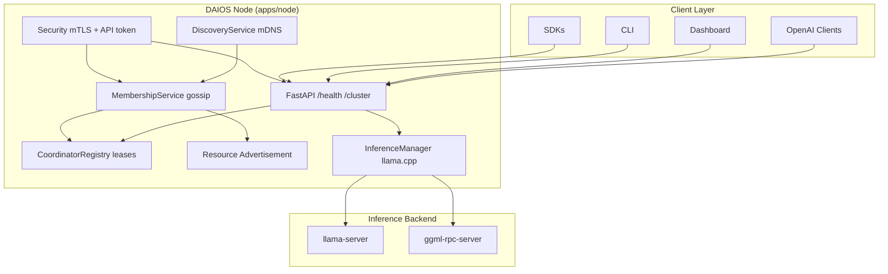

# Phase 2 — Complete Engineering Specification

**Status:** Gen 2 implemented · Gens 3–5 specified  
**Version:** 0.2.0  
**Last updated:** 2026-06-30

---

## Mission

Phase 1 finalized the architecture and long-term vision for the Distributed AI Operating System (DAIOS). Phase 2 transforms that vision into an implementable engineering specification that enables incremental delivery across five generations without major rewrites.

The specification defines every repository, service, protocol, API, interface, configuration schema, algorithm, and migration path required to evolve from a two-node prototype into a production-ready peer-to-peer distributed AI operating system.

Document style combines:

- Software Requirements Specification (SRS)
- Internet RFC
- Kubernetes Enhancement Proposal (KEP)
- Google Engineering Design Document
- OpenAPI Specification
- Protocol Design Specification

---

## Engineering Philosophy

The platform must **evolve rather than be rewritten**. Every subsystem answers:

| Question | Purpose |
|---|---|
| What exists today? | Ground truth for implementers |
| What will be reused? | Minimize churn |
| What will be extended? | Incremental growth |
| What will eventually be replaced? | Planned obsolescence |
| How can migration occur without breaking users? | Compatibility contract |

Stable public APIs are preferred over large architectural rewrites. Open-source components (llama.cpp, GGML RPC) remain until benchmarking justifies replacement.

---

## Current Implementation Status

| Generation | Status | Location |
|---|---|---|
| Gen 1 — Prototype | Complete | `apps/node`, `apps/launcher`, `apps/dashboard` |
| Gen 2 — P2P Platform | **Implemented** | `apps/node` (interim), `packages/protocol` |
| Gen 3 — Distributed Scheduler | Specified | `docs/phase-2/07-scheduler-spec.md` |
| Gen 4 — Native Distributed Inference | Specified | `docs/phase-2/03-build-vs-buy-matrix.md` |
| Gen 5 — Complete DAIOS | Specified | `docs/phase-2/02-generation-roadmap.md` |

Gen 2 is opt-in via `discovery.enabled: true` and remains backward compatible with Gen 1 manual YAML peer configuration.

---

## Specification Index

| # | Document | Scope |
|---|---|---|
| 01 | [Repository Architecture](phase-2/01-repository-architecture.md) | Target layout, interim `apps/node` placement |
| 02 | [Generation Roadmap](phase-2/02-generation-roadmap.md) | Gen 1–5 objectives and exit criteria |
| 03 | [Build vs Buy Matrix](phase-2/03-build-vs-buy-matrix.md) | Component reuse/replace decisions |
| 04 | [Service Specifications](phase-2/04-service-specifications.md) | Per-service SRS |
| 05 | [Node Architecture](phase-2/05-node-architecture.md) | Lifecycle, join, recovery |
| 06 | [Dynamic Coordinator](phase-2/06-dynamic-coordinator.md) | Ephemeral per-request leases |
| 07 | [Scheduler Specification](phase-2/07-scheduler-spec.md) | Gen 3 algorithms (future) |
| 08 | [Resource Contribution](phase-2/08-resource-contribution.md) | Advertisement and placement |
| 09 | [Networking Specification](phase-2/09-networking-spec.md) | mDNS, gossip, transports |
| 10 | [API Specifications](phase-2/10-api-specifications.md) | REST, OpenAI-compat, internal |
| 11 | [Protocol Definitions](phase-2/11-protocol-definitions.md) | Wire messages and schemas |
| 12 | [Migration Strategy](phase-2/12-migration-strategy.md) | Rolling upgrades, feature flags |
| 13 | [Dashboard & Desktop](phase-2/13-dashboard-desktop-spec.md) | UI specifications |
| 14 | [CLI & SDK](phase-2/14-cli-sdk-spec.md) | Client tooling |
| 15 | [Plugin Architecture](phase-2/15-plugin-architecture.md) | Extension framework |
| 16 | [Security Specification](phase-2/16-security-spec.md) | mTLS, tokens, identity |
| 17 | [Testing & Performance](phase-2/17-testing-performance.md) | QA and SLO targets |
| 18 | [Implementation Order](phase-2/18-implementation-order.md) | Step-by-step delivery plan |

---

## Deliverables Checklist

- [x] Repository architecture
- [x] Generation roadmap (Gen 1–5)
- [x] Build vs Buy matrix
- [x] Complete service specifications
- [x] Node architecture
- [x] Dynamic coordinator specification
- [x] Scheduler specification (Gen 3 design)
- [x] Resource contribution algorithms
- [x] Networking specification
- [x] API specifications
- [x] Protocol definitions
- [x] Configuration schemas (`packages/protocol`)
- [x] Migration strategies
- [x] Dashboard specification
- [x] Desktop application specification
- [x] CLI specification
- [x] SDK specifications
- [x] Plugin architecture
- [x] Security specification
- [x] Testing strategy
- [x] Performance targets
- [x] Mermaid diagrams (throughout sub-docs)
- [x] Step-by-step implementation order
- [ ] CI/CD strategy (deferred to deploy/)
- [ ] Operations / Troubleshooting guides (deferred to docs/)

---

## High-Level Architecture (Gen 2)

---

## Key Design Decisions (Gen 2)

1. **No permanent master** — any node may coordinate a single inference request via ephemeral lease.
2. **Opt-in discovery** — `discovery.enabled: false` preserves Gen 1 manual peer YAML.
3. **Interim layout** — Gen 2 modules live in `apps/node/src/daios_node/` until migrated to `node/*`.
4. **Protocol package** — shared Pydantic models in `packages/protocol` for config, health, and wire messages.
5. **Inference unchanged** — llama.cpp + GGML RPC remain the distributed inference backend through Gen 2–3.

---

## References

- Phase 1 research & architecture: `docs/phase-1-research-architecture.md`
- Phase 2 source spec: `goal/Phase_2_Engineering_Specification.md`
- Gen 2 examples: `examples/two-node-discovered/`
- Test suite: `tests/test_discovery.py`, `tests/test_membership.py`, `tests/test_coordinator.py`
- Testing & performance: `docs/phase-2/17-testing-performance.md`
