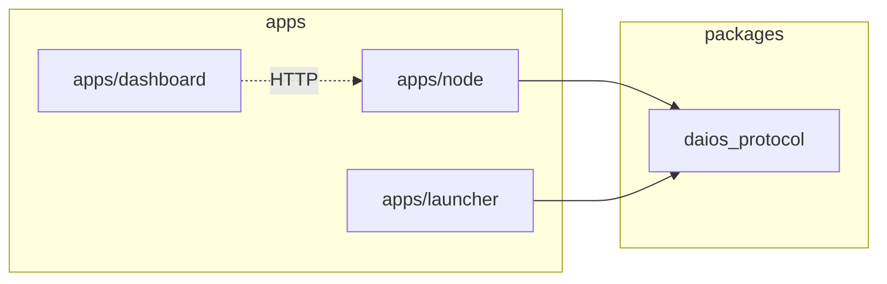

# 01 — Repository Architecture

**Status:** Target layout defined · Gen 2 interim in `apps/node`  
**SRS ID:** DAIOS-ARCH-001

---

## Purpose

Define a monorepo structure that supports five implementation generations without directory churn. The layout separates deployable applications, node runtime modules, shared packages, client SDKs, and operational assets.

---

## Target Directory Layout

```
distributed-ai-os/
├── apps/
│   ├── desktop/          # Gen 5 native shell (Tauri/Electron) — planned
│   ├── dashboard/        # React SPA — Gen 1+ implemented
│   ├── cli/              # daios CLI — Gen 2 stub, Gen 5 full
│   └── launcher/         # Process orchestrator for dev/demo — Gen 1+
├── node/                 # Target home for runtime modules (Gen 3+ migration)
│   ├── discovery/
│   ├── networking/
│   ├── scheduler/        # Gen 3
│   ├── worker/
│   ├── coordinator/
│   ├── inference/
│   ├── resources/
│   ├── model-manager/
│   ├── storage/
│   ├── security/
│   └── telemetry/
├── packages/
│   ├── protocol/         # Pydantic schemas — Gen 2 implemented
│   ├── rpc/              # GGML RPC wrappers — planned
│   ├── serialization/    # MessagePack/Protobuf — Gen 3+
│   ├── compression/      # zstd for model transfer — Gen 4+
│   └── plugins/          # Plugin host SDK — Gen 5
├── sdk/
│   ├── python/
│   ├── javascript/
│   ├── rust/
│   └── go/
├── deploy/               # Docker, K8s manifests, systemd units
├── docs/
│   └── phase-2/          # This specification set
├── examples/             # Runnable YAML configs per generation
├── benchmarks/           # Latency/throughput harnesses
├── scripts/              # install-dev.sh, cert generation
└── tests/                # Unit + integration across packages
```

---

## Interim Gen 2 Placement

Gen 2 modules currently reside in `apps/node/src/daios_node/`:

| Module | Interim Path | Target Path |
|---|---|---|
| Discovery (mDNS) | `daios_node/discovery.py` | `node/discovery/` |
| Membership (gossip) | `daios_node/membership.py` | `node/networking/` |
| Coordinator | `daios_node/coordinator.py` | `node/coordinator/` |
| Resources | `daios_node/resources.py` | `node/resources/` |
| Security | `daios_node/security.py` | `node/security/` |
| Inference | `daios_node/inference.py` | `node/inference/` |
| FastAPI app | `daios_node/app.py` | `node/worker/` entry |

Migration to `node/*` is a **refactor-only** change; public APIs and config schemas remain stable.

---

## Package Boundaries



**Rule:** `packages/protocol` must not import from `apps/*`. Apps depend on packages, never the reverse.

---

## Directory Responsibilities

### `apps/node`

Single deployable Python package (`daios-node` on PyPI path). Entry point: `daios-node --config config.yaml`. Hosts FastAPI, background discovery/membership loops, and inference subprocess management.

### `apps/launcher`

Development orchestrator that spawns coordinator + worker nodes with generated YAML. Not required in production; nodes run independently.

### `apps/dashboard`

Vite + React SPA. Talks to node REST API and launcher API. Topology graph, resource panels, chat interface.

### `packages/protocol`

Source of truth for:

- `NodeConfig` and nested config models
- `MemberInfo`, `MembershipView`, `CoordinatorLease`
- `HeartbeatMessage`, `LeaveMessage`
- Health response types

Published as editable install: `uv pip install -e packages/protocol`.

### `sdk/*`

Thin HTTP/gRPC clients wrapping public APIs. Python SDK is first priority (Gen 3); JS/Rust/Go follow Gen 5.

### `examples/`

| Directory | Generation |
|---|---|
| `two-node/` | Gen 1 manual peers |
| `two-node-discovered/` | Gen 2 mDNS |
| `scheduler-demo/` | Gen 3 (planned) |

### `tests/`

Pytest suite at repo root. Integration tests spin two nodes on loopback with `discovery.enabled: true`.

---

## Build System

| Tool | Usage |
|---|---|
| `uv` | Python workspace, editable packages |
| `npm` | Dashboard frontend |
| `make` | Top-level targets: `make test`, `make dashboard`, `make launcher` |
| `pyproject.toml` | Per-package metadata in `apps/node`, `packages/protocol`, `apps/launcher` |

---

## Versioning Convention

- **Protocol package:** Semver; breaking schema changes require major bump + migration doc.
- **Node API:** `/health` returns `generation` field; OpenAI proxy is unversioned (OpenAI-compat).
- **Config:** Unknown YAML keys ignored; new fields have safe defaults.

---

## CI/CD Placement (Future)

```
deploy/
├── docker/
│   └── Dockerfile.node
├── compose/
│   └── two-node.yml
└── github-actions/   # lint, test, benchmark regression
```

CI runs `pytest`, `ruff`, dashboard `npm test`, and optional two-node integration on every PR.

---

## Acceptance Criteria

- [x] Gen 2 code runnable from `apps/node` without `node/` directory existing
- [ ] `node/` directory populated module-by-module starting Gen 3
- [ ] No circular imports between packages
- [ ] Examples runnable via `daios-node --config examples/...`
