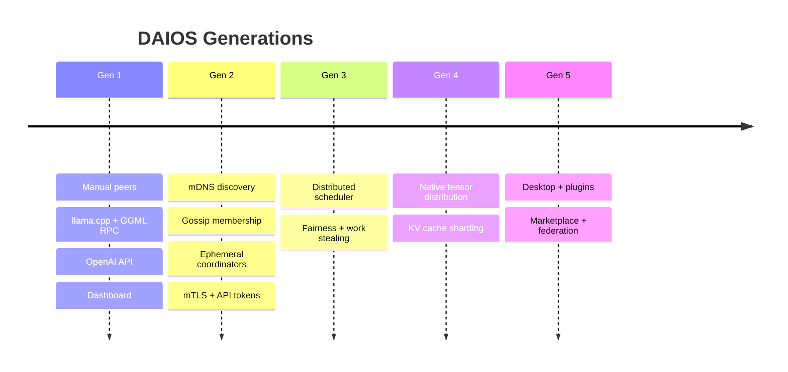

# 02 — Generation Roadmap

**Status:** Gen 1–2 complete · Gen 3–5 specified  
**SRS ID:** DAIOS-ROADMAP-002

---

## Overview

DAIOS evolves through five generations. Each generation adds capabilities while preserving prior APIs and configuration. No generation requires a full rewrite of the inference stack unless Gen 4 benchmarks justify it.

---

## Generation 1 — Prototype

**Objective:** Prove two machines can execute one distributed inference request.

| Component | Implementation |
|---|---|
| Inference | llama.cpp `llama-server` + `ggml-rpc-server` |
| Orchestration | Manual YAML `peers:` list |
| API | OpenAI-compatible `/v1/chat/completions` proxy |
| UI | React dashboard + launcher |
| Config | `NodeConfig` with `PeerConfig` |

**Exit criteria:**

- Two-node benchmark completes inference with measurable token throughput
- Dashboard shows peer status and live logs
- `tests/test_gguf_context.py` validates model loading

**Status:** Complete.

---

## Generation 2 — Peer-to-Peer Platform

**Objective:** Replace manual orchestration with automatic discovery, membership, and per-request coordination.

| Component | Implementation |
|---|---|
| Discovery | mDNS `_daios._tcp.local.` via `zeroconf` |
| Membership | HTTP heartbeat gossip, suspect/dead detection |
| Coordinator | `CoordinatorRegistry` ephemeral leases (300s TTL) |
| Resources | `psutil` + optional `nvidia-smi` advertisement |
| Security | Optional mTLS (auto dev certs), `ApiTokenMiddleware` |
| Protocol | `packages/protocol` message types |

**Config gate:** `discovery.enabled: true` (default `false` for backward compatibility).

**Exit criteria:**

- [x] Two nodes auto-discover on LAN without YAML peers
- [x] Membership view converges within `failure_timeout` (15s)
- [x] Coordinator lease selects workers by resource score
- [x] Graceful leave via `LeaveMessage`
- [x] Integration tests in `tests/test_membership_integration.py`

**Status:** Implemented in `apps/node`.

---

## Generation 3 — Distributed Scheduler

**Objective:** Replace greedy worker selection with a cluster-wide scheduler supporting fairness, latency awareness, and work stealing.

| Capability | Description |
|---|---|
| Dynamic node selection | Score function with network RTT, GPU VRAM, thermal state |
| Multi-user fairness | Weighted fair queueing per tenant |
| Interactive prioritization | Low-latency queue for chat; background for batch |
| Work stealing | Idle nodes pull tasks from overloaded peers |
| Coordinator cooperation | Multiple coordinators negotiate via scheduler service |

**Constraints:**

- Inference backend remains llama.cpp + GGML RPC
- Scheduler runs as `node/scheduler/` module
- Gen 2 `CoordinatorRegistry._select_workers` becomes scheduler client

**Exit criteria (future):**

- 8-node cluster maintains P95 latency SLO under mixed workload
- No starvation after 1000 requests from 10 clients
- Scheduler failover < 5s

**Status:** Specified in `07-scheduler-spec.md`. Not implemented.

---

## Generation 4 — Native Distributed Inference

**Objective:** Replace GGML RPC with native distributed tensor execution if benchmarks show ≥20% throughput improvement at 8+ nodes.

| Capability | Description |
|---|---|
| Distributed tensor execution | Partition layers across nodes |
| Distributed KV cache | Shard cache by sequence position |
| Activation routing | Pipeline parallelism with backpressure |
| Streaming execution | Token stream without full-graph sync |
| Heterogeneous execution | CPU/GPU mix per layer |

**Migration:**

- OpenAI API unchanged
- `inference.backend` adds `daios-native` option
- GGML RPC remains fallback via feature flag

**Benchmark gate:** `benchmarks/native-vs-rpc/` must pass before default switch.

**Status:** Specified. Not implemented.

---

## Generation 5 — Complete Distributed AI OS

**Objective:** Production platform with desktop app, plugin ecosystem, enterprise features.

| Capability | Description |
|---|---|
| Desktop | Tauri shell: join cluster, resource sliders, notifications |
| Plugins | Hot-load schedulers, inference backends, auth providers |
| Federation | Cross-cluster routing via gateway nodes |
| Marketplace | Model and plugin distribution |
| SDKs | Python, JS, Rust, Go with parity |
| Auto-update | Signed release channel |

**Status:** Specified. Not implemented.

---

## Compatibility Matrix

| From → To | Config | API | Protocol |
|---|---|---|---|
| Gen 1 → Gen 2 | Add `discovery:` block; peers optional | Unchanged | +heartbeat endpoints |
| Gen 2 → Gen 3 | Add `scheduler:` block | +`/scheduler/*` | +schedule messages |
| Gen 3 → Gen 4 | `inference.backend: daios-native` | Unchanged | +tensor wire format |
| Gen 4 → Gen 5 | +`plugins:` | +plugin registry API | +plugin manifest |

---

## Risk Register

| Generation | Risk | Mitigation |
|---|---|---|
| Gen 2 | mDNS blocked on corporate LAN | Manual peers fallback; Gen 3 static seed list |
| Gen 3 | Scheduler single point of logic bugs | Chaos tests; work-stealing fallback to Gen 2 greedy |
| Gen 4 | Native inference correctness | Extensive parity tests vs llama.cpp reference |
| Gen 5 | Plugin sandbox escapes | WASM sandbox; capability-based permissions |

---

## Timeline Guidance

| Generation | Estimated Effort | Dependency |
|---|---|---|
| Gen 1 | Done | — |
| Gen 2 | Done | Gen 1 |
| Gen 3 | 8–12 engineer-weeks | Gen 2 stable |
| Gen 4 | 16–24 engineer-weeks | Gen 3 + benchmark harness |
| Gen 5 | 24+ engineer-weeks | Gen 4 or Gen 3 if Gen 4 deferred |
