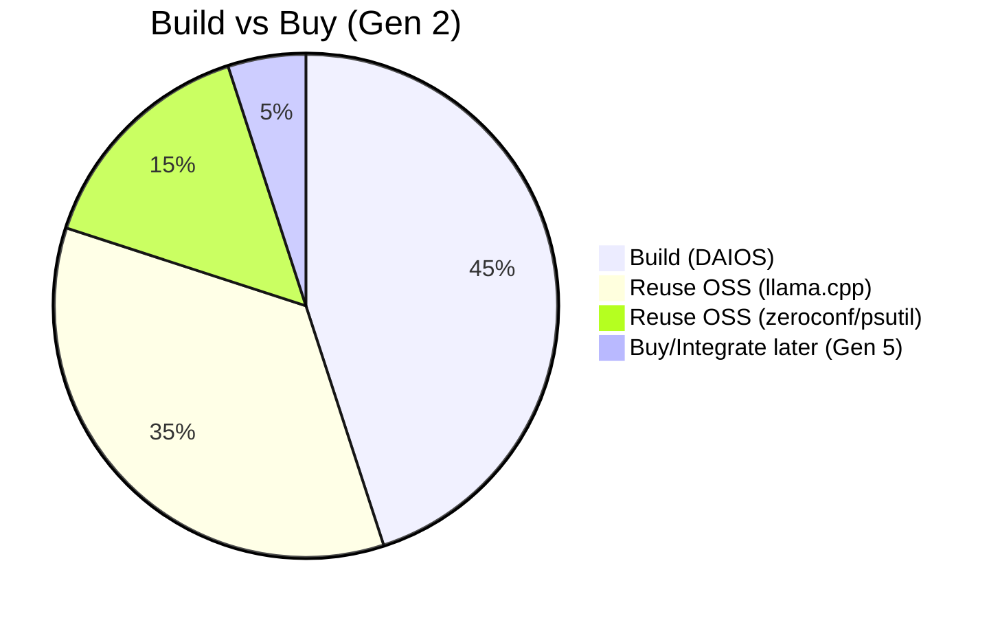

# 03 — Build vs Buy Matrix

**Status:** Gen 2 decisions locked · Gen 3–5 provisional  
**SRS ID:** DAIOS-BVB-003

---

## Purpose

For every subsystem, document what exists today, when it was introduced, reuse/extend/replace strategy, migration path, risks, effort, and benchmarking criteria for replacement.

---

## Matrix

### Inference Engine

| Field | Value |
|---|---|
| Current implementation | llama.cpp `llama-server` + `ggml-rpc-server` |
| Generation introduced | Gen 1 |
| Reuse | Entire stack through Gen 3 |
| Extend | `tensor_split`, `n_gpu_layers`, `rpc_cache` config |
| Replace | Gen 4 native distributed inference (benchmark-gated) |
| Migration | `inference.backend: llama.cpp \| mock \| daios-native` |
| Risk | GGML RPC latency at WAN scale; version pinning |
| Effort to replace | 16–24 engineer-weeks (Gen 4) |
| Benchmarking | Throughput tokens/s, P95 latency, 8-node scaling curve |

### Discovery

| Field | Value |
|---|---|
| Current implementation | mDNS via `zeroconf` (`_daios._tcp.local.`) |
| Generation introduced | Gen 2 |
| Reuse | LAN discovery indefinitely |
| Extend | Static seed list, DNS-SD, bootstrap nodes (Gen 3) |
| Replace | Optional Consul/etcd for enterprise (Gen 5) |
| Migration | `discovery.mdns: true` remains default; add `discovery.seeds: []` |
| Risk | mDNS filtered on VLANs; multicast blocked |
| Effort | 2 engineer-weeks for seed list |
| Benchmarking | Time-to-first-peer < 10s on LAN |

### Networking (Inter-node)

| Field | Value |
|---|---|
| Current implementation | HTTP/1.1 heartbeat over `httpx`; GGML RPC binary |
| Generation introduced | Gen 1 (RPC), Gen 2 (HTTP gossip) |
| Reuse | HTTP for control plane |
| Extend | HTTP/2, connection pooling (Gen 3) |
| Replace | gRPC or QUIC for control plane (Gen 3+) |
| Migration | Version negotiation on `/health`; dual-listen period |
| Risk | Head-of-line blocking on HTTP/1.1 |
| Effort | 4–6 engineer-weeks for gRPC migration |
| Benchmarking | Heartbeat RTT P99, connection count at 64 nodes |

### Scheduler

| Field | Value |
|---|---|
| Current implementation | Greedy `score_peer_for_placement` in `coordinator.py` |
| Generation introduced | Gen 2 (minimal), Gen 3 (full) |
| Reuse | Scoring function as scheduler plugin input |
| Extend | Priority queues, fairness (Gen 3) |
| Replace | N/A — built in-house |
| Migration | Feature flag `scheduler.enabled`; fallback to greedy |
| Risk | Scheduler bugs cause starvation |
| Effort | 8–12 engineer-weeks |
| Benchmarking | Jain's fairness index ≥ 0.9 at 10 clients |

### Coordinator

| Field | Value |
|---|---|
| Current implementation | `CoordinatorRegistry` in-memory leases |
| Generation introduced | Gen 2 |
| Reuse | Lease model through Gen 5 |
| Extend | Persistent lease log for recovery (Gen 3) |
| Replace | No permanent master — design invariant |
| Migration | Lease TTL configurable; API unchanged |
| Risk | Lease expiry mid-request |
| Effort | 1 engineer-week for TTL tuning |
| Benchmarking | Coordinator overhead < 5ms per request |

### API Gateway

| Field | Value |
|---|---|
| Current implementation | FastAPI in `daios_node/app.py` |
| Generation introduced | Gen 1 |
| Reuse | FastAPI + OpenAI proxy |
| Extend | Rate limiting, request ID propagation (Gen 3) |
| Replace | Optional Envoy sidecar (Gen 5 enterprise) |
| Migration | All routes remain on node; sidecar is transparent |
| Risk | Single-process bottleneck |
| Effort | 2 engineer-weeks for rate limiting |
| Benchmarking | 500 concurrent SSE streams without OOM |

### Dashboard

| Field | Value |
|---|---|
| Current implementation | React + Vite in `apps/dashboard` |
| Generation introduced | Gen 1 |
| Reuse | Entire SPA; extend panels per generation |
| Extend | Topology graph, membership view (Gen 2 done) |
| Replace | None planned |
| Migration | API-driven; no coupling to node internals |
| Risk | Polling load on large clusters |
| Effort | 1 engineer-week for WebSocket push (Gen 3) |
| Benchmarking | UI refresh < 100ms for 32-node topology |

### Desktop

| Field | Value |
|---|---|
| Current implementation | None (dashboard in browser) |
| Generation introduced | Gen 5 |
| Reuse | Dashboard components via WebView |
| Extend | — |
| Replace | — |
| Migration | Desktop wraps same REST API |
| Risk | Cross-platform packaging |
| Effort | 12+ engineer-weeks |
| Benchmarking | Cold start < 3s |

### CLI

| Field | Value |
|---|---|
| Current implementation | `daios-launcher` only |
| Generation introduced | Gen 1 (launcher), Gen 5 (full CLI) |
| Reuse | Launcher for dev |
| Extend | `daios cluster`, `daios node` commands (Gen 3) |
| Replace | — |
| Migration | CLI calls same APIs as dashboard |
| Risk | Config drift vs YAML |
| Effort | 4 engineer-weeks |
| Benchmarking | N/A |

### SDKs

| Field | Value |
|---|---|
| Current implementation | None (direct HTTP) |
| Generation introduced | Gen 3 (Python), Gen 5 (others) |
| Reuse | OpenAPI spec as source |
| Extend | Streaming helpers |
| Replace | — |
| Migration | Generated from OpenAPI |
| Risk | API drift |
| Effort | 2 engineer-weeks per language |
| Benchmarking | SDK overhead < 1ms per call |

### Security

| Field | Value |
|---|---|
| Current implementation | Optional mTLS, API bearer token |
| Generation introduced | Gen 2 |
| Reuse | Cert paths, middleware pattern |
| Extend | JWT, RBAC (Gen 5) |
| Replace | Dev self-signed → CA-issued (ops) |
| Migration | `security.mtls_enabled` opt-in |
| Risk | Auto-generated dev certs in production |
| Effort | 4 engineer-weeks for RBAC |
| Benchmarking | TLS handshake < 50ms |

### Telemetry

| Field | Value |
|---|---|
| Current implementation | Python `logging` to files |
| Generation introduced | Gen 1 |
| Reuse | Log format |
| Extend | Prometheus `/metrics` (Gen 3) |
| Replace | Optional OpenTelemetry exporter (Gen 5) |
| Migration | Add endpoint; no breaking changes |
| Risk | Log volume on large clusters |
| Effort | 2 engineer-weeks |
| Benchmarking | Metrics scrape < 100ms |

### Storage / Model Loader

| Field | Value |
|---|---|
| Current implementation | Local filesystem `model_path` |
| Generation introduced | Gen 1 |
| Reuse | Local path |
| Extend | Shared NFS, S3 pull (Gen 4) |
| Replace | Model manager service (Gen 4) |
| Migration | `model_path` remains; add `model_uri` |
| Risk | Large model transfer time |
| Effort | 6 engineer-weeks |
| Benchmarking | Model pull < 10% of load time |

### Configuration

| Field | Value |
|---|---|
| Current implementation | YAML + Pydantic `NodeConfig` |
| Generation introduced | Gen 1 |
| Reuse | Entire schema |
| Extend | New nested blocks per generation |
| Replace | None |
| Migration | Unknown keys ignored; defaults safe |
| Risk | Schema drift across nodes |
| Effort | Minimal per field |
| Benchmarking | Config load < 10ms |

### Resource Manager

| Field | Value |
|---|---|
| Current implementation | `resources.py` + `ResourceCapsConfig` |
| Generation introduced | Gen 2 |
| Reuse | `gather_advertisement`, scoring |
| Extend | Thermal, battery signals (partial) |
| Replace | Scheduler-owned allocation (Gen 3) |
| Migration | Caps remain user-facing |
| Risk | Overcommit on noisy metrics |
| Effort | 2 engineer-weeks |
| Benchmarking | Refuse-work accuracy vs manual caps |

---

## Decision Summary

**Principle:** Buy (integrate mature OSS) for inference and discovery on LAN; build control plane, coordinator, and scheduler in-house for P2P semantics.
