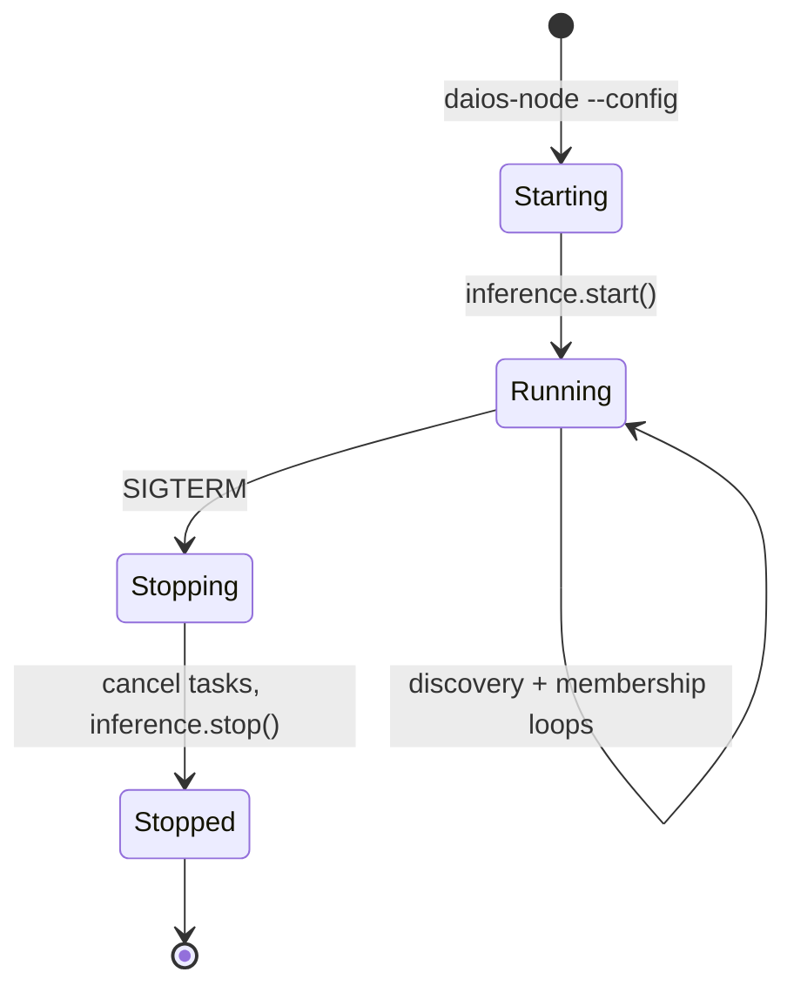
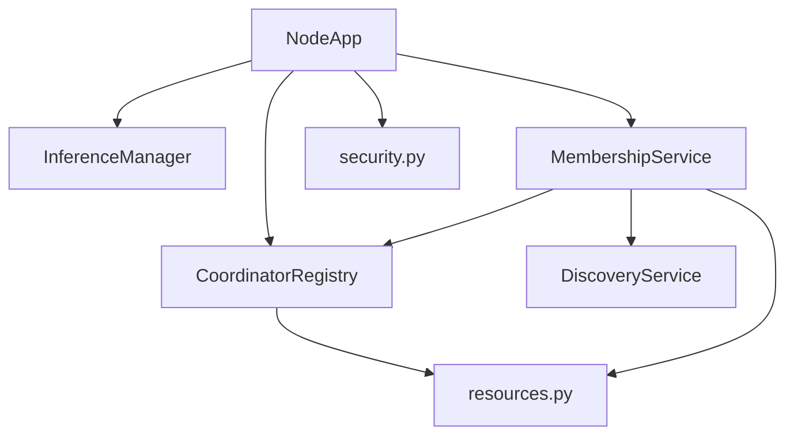

# 04 — Service Specifications

**Status:** Gen 2 services implemented  
**SRS ID:** DAIOS-SVC-004

---

## Purpose

Define every runtime service with purpose, responsibilities, dependencies, interfaces, configuration, observability, lifecycle, scaling, failure recovery, migration, and future evolution.

---

## Service: Node API (`NodeApp`)

### Purpose

HTTP control plane and OpenAI-compatible inference proxy for a single DAIOS node.

### Responsibilities

- Serve `/health`, `/cluster`, `/membership`, `/v1/*`
- Proxy chat completions to local `llama-server`
- Accept heartbeat and leave messages from peers
- Enforce API token middleware when configured

### Dependencies

- `packages/protocol` (config, health types)
- `InferenceManager`, `MembershipService`, `DiscoveryService`, `CoordinatorRegistry`
- `httpx` for outbound peer calls

### Interfaces

| Direction | Endpoint / Channel | Payload |
|---|---|---|
| Input | `GET /health` | — |
| Input | `GET /cluster` | — |
| Input | `POST /v1/chat/completions` | OpenAI JSON |
| Input | `POST /internal/heartbeat` | `HeartbeatMessage` |
| Input | `POST /internal/leave` | `LeaveMessage` |
| Output | Inference backend | HTTP to `llama-server` |
| Output | Peer gossip | HTTP to peer `/internal/heartbeat` |

### Configuration

```yaml
node_id: worker-1
role: hybrid
network:
  api_port: 8000
discovery:
  enabled: true
security:
  api_token: "${DAIOS_API_TOKEN}"
```

### Health / Metrics

- **Health:** `GET /health` → `NodeHealth` (inference process states, uptime, resources)
- **Metrics:** Logging only (Gen 3: Prometheus `/metrics`)
- **Logging:** Structured via Python `logging`; level from env `DAIOS_LOG_LEVEL`

### Lifecycle



### Scaling

- One process per machine; horizontal scale by adding nodes
- No in-process worker pool for API (async FastAPI)

### Failure Recovery

- Inference subprocess restart on crash (Gen 2: manual via restart)
- Membership marks peer SUSPECT → DEAD after `failure_timeout`

### Migration

- Gen 1: `discovery.enabled: false`, manual peers
- Gen 2+: auto peer sync to inference `set_peer_hosts()`

### Future Evolution

- Gen 3: scheduler callbacks on `/internal/schedule`
- Gen 5: plugin hooks on request path

---

## Service: DiscoveryService

### Purpose

Advertise and discover peers on LAN via mDNS.

### Responsibilities

- Register `_daios._tcp.local.` with TXT records: `node_id`, `role`, `api_port`, `rpc_port`
- Invoke callback on new peer discovery
- Periodic re-advertisement per `advertise_interval`

### Dependencies

- `zeroconf` (optional; graceful degrade if missing)
- `NodeConfig.discovery`

### Configuration

```yaml
discovery:
  enabled: true
  mdns: true
  cluster_name: daios-home
  advertise_interval: 5.0
```

### Health

- Internal: logs registration success/failure
- No dedicated endpoint

### Failure Recovery

- Retry registration on network interface change
- Falls back to manual peers if zeroconf unavailable

### Future Evolution

- Gen 3: static seed bootstrap
- Gen 5: DNS-based discovery for WAN

---

## Service: MembershipService

### Purpose

Eventually-consistent cluster membership via heartbeat gossip.

### Responsibilities

- Maintain local `MembershipView`
- Send/receive `HeartbeatMessage` with resource advertisements
- Detect SUSPECT and DEAD peers
- Propagate `LeaveMessage` on graceful shutdown
- Increment `membership_version` on view changes

### Dependencies

- `DiscoveryService`, `CoordinatorRegistry`, `httpx`

### Configuration

```yaml
membership:
  heartbeat_interval: 5.0
  failure_timeout: 15.0
  gossip_interval: 10.0
```

### Interfaces

| Output | `get_membership_view()` → `MembershipView` |
| Output | `get_alive_worker_hosts()` → list of RPC hosts |

### Failure Recovery

- Dead peers excluded from coordinator worker selection
- Rejoin: new heartbeats restore ALIVE status

### Future Evolution

- Gen 3: anti-entropy with Merkle sync for large clusters
- SWIM protocol replacement if gossip scales poorly past 64 nodes

---

## Service: CoordinatorRegistry

### Purpose

Ephemeral per-request coordinator leases; no permanent cluster master.

### Responsibilities

- `create_lease(members, request_id)` → `CoordinatorLease`
- Greedy worker selection via `score_peer_for_placement`
- TTL expiry and cleanup (default 300s)

### Dependencies

- `MembershipService` member list
- `resources.should_refuse_work`, `score_peer_for_placement`

### Failure Recovery

- Expired leases deleted on access
- New request creates new lease on any alive node

### Future Evolution

- Gen 3: scheduler assigns workers; registry stores scheduler decision
- Lease persistence for long-running batch jobs

---

## Service: InferenceManager

### Purpose

Manage `llama-server` and `ggml-rpc-server` subprocesses.

### Responsibilities

- Start/stop inference backend per config
- Configure RPC peer hosts from membership
- Expose `InferenceStatus` to health endpoint

### Configuration

```yaml
inference:
  backend: llama.cpp
  model_path: /models/model.gguf
  llama_server_port: 8080
  n_gpu_layers: 99
  rpc_cache: false
```

### Failure Recovery

- Process crash → `ProcessState.FAILED` in health
- Gen 3: automatic restart with backoff

---

## Service: Launcher (`daios-launcher`)

### Purpose

Development orchestrator; spawns nodes with generated YAML.

### Responsibilities

- Validate configs
- Start coordinator + worker processes
- Expose launcher API for dashboard

### Dependencies

- `apps/launcher`, dashboard `api/launcher.ts`

### Future Evolution

- Deprecated for production; replaced by systemd/Docker in `deploy/`

---

## Cross-Service Dependency Graph


