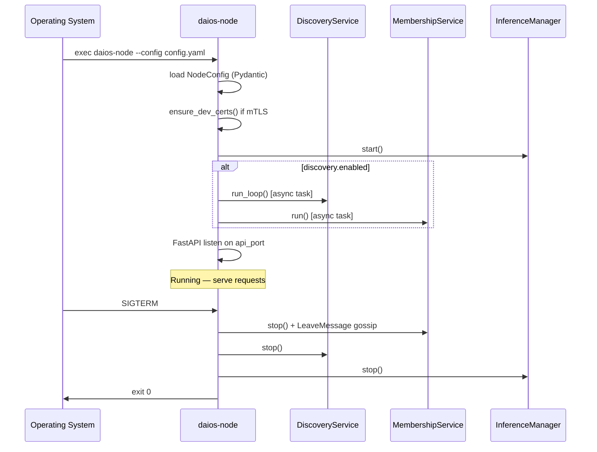

# 05 — Node Architecture

**Status:** Gen 2 implemented  
**SRS ID:** DAIOS-NODE-005

---

## Design Invariant

**Every node runs identical software.** There is no permanent master node. Any node may serve API requests, contribute RPC compute, and coordinate a single inference request via ephemeral lease.

Roles (`coordinator`, `worker`, `hybrid`) are configuration hints only; Gen 2+ ignores role for coordination authority.

---

## Node Lifecycle



### States

| State | Description |
|---|---|
| `STARTING` | Config load, cert setup, inference subprocess spawn |
| `RUNNING` | API accepting; background loops active |
| `DRAINING` | Gen 3+: refuse new leases, complete in-flight |
| `STOPPING` | Cancel tasks, send leave, stop inference |
| `STOPPED` | Process exited |

---

## Discovery Phase

When `discovery.enabled: true`:

1. `DiscoveryService` registers mDNS service `_daios._tcp.local.`
2. TXT records publish `node_id`, `role`, `api_port`, `rpc_port`, `cluster_name`
3. Listener callback adds discovered peers to membership seed list
4. Re-advertise every `advertise_interval` seconds (default 5s)

When `discovery.enabled: false` (Gen 1 mode):

- Peers loaded from `peers:` YAML list
- `check_all_peers()` probes reachability on `/cluster`

---

## Authentication

| Layer | Mechanism | Config |
|---|---|---|
| API | Bearer token middleware | `security.api_token` |
| Inter-node HTTP | Optional mTLS | `security.mtls_enabled` |
| GGML RPC | None (LAN trust) | Gen 3: mTLS wrapper |

Unauthenticated requests to protected endpoints receive `401 Unauthorized`.

---

## Cluster Join

1. Node starts and advertises via mDNS (or reads static peers)
2. `MembershipService` sends `HeartbeatMessage` to known members
3. Recipients merge sender into `_members` if `membership_version` ≥ existing
4. Response includes full member list (gossip propagation)
5. Local node appears in remote `MembershipView` within one `heartbeat_interval`

**No explicit join RPC** — membership is pull/push via heartbeats.

---

## Heartbeat

```yaml
# HeartbeatMessage (POST /internal/heartbeat)
sender: MemberInfo          # full local state
membership_version: int
advertisement: ResourceAdvertisement
active_leases: [CoordinatorLease]
```

Interval: `membership.heartbeat_interval` (default 5s).  
RTT measured per peer stored in `rtt_ms` map on advertisement.

---

## Resource Advertisement

Each heartbeat carries `ResourceAdvertisement`:

- CPU percent, available cores
- RAM total/available GB
- GPU via `nvidia-smi` (optional)
- Disk free, battery, configured caps
- `current_workload` = count of active coordinator leases

---

## Coordinator Election (Gen 2)

**There is no election.** The node receiving an inference request becomes coordinator:

1. Client POST `/v1/chat/completions` hits node A
2. Node A calls `coordinator_registry.create_lease(members)`
3. Lease records `coordinator_node_id=A`, `worker_endpoints=[...]`
4. Node A configures llama-server with selected RPC peers
5. Lease expires after 300s or request completion

Concurrent requests on different nodes → multiple concurrent coordinators (by design).

---

## Inference Execution

1. Coordinator selects up to 4 worker RPC endpoints
2. `InferenceManager.set_peer_hosts(hosts)` updates ggml-rpc config
3. `llama-server` distributes tensors via GGML RPC
4. OpenAI response streamed or returned to client

---

## Idle Mode

When no active inference:

- Inference subprocess may remain running (model loaded)
- `ModelUsage.status` = `idle`
- Node still participates in gossip
- Resources fully advertised; eligible for remote placement

Gen 3: idle nodes participate in work stealing.

---

## Shutdown

1. `MembershipService.stop()` sends `LeaveMessage` to all known peers
2. Background asyncio tasks cancelled
3. mDNS deregistration
4. Inference subprocesses terminated
5. Peers mark node LEAVING → remove after timeout

---

## Recovery

| Scenario | Behavior |
|---|---|
| Peer crash (no leave) | SUSPECT after timeout/2; DEAD after `failure_timeout` |
| Network partition | Both sides may mark other DEAD; rejoin heals on reconnect |
| Coordinator crash mid-request | Client timeout; retry on another node (new lease) |
| Local restart | New `membership_version`; peers update on next heartbeat |

---

## Rejoin

After restart:

1. Same `node_id` in config → peers replace stale entry on heartbeat
2. mDNS re-advertise triggers rediscovery
3. No durable cluster state to restore (Gen 2)

Gen 3: scheduler state may require brief catch-up sync.

---

## Role Configuration

```yaml
role: hybrid   # coordinator | worker | hybrid
runs_rpc_server: true
runs_api_server: true
```

`hybrid` is recommended for home/small clusters. Large deployments may dedicate `worker` nodes with `runs_api_server: false` (Gen 3).

---

## Acceptance Criteria (Gen 2)

- [x] Identical binary/config schema for all nodes
- [x] No node holds permanent coordinator lock
- [x] Graceful shutdown propagates within 2 × heartbeat_interval
- [x] Dead peer excluded from placement within failure_timeout
