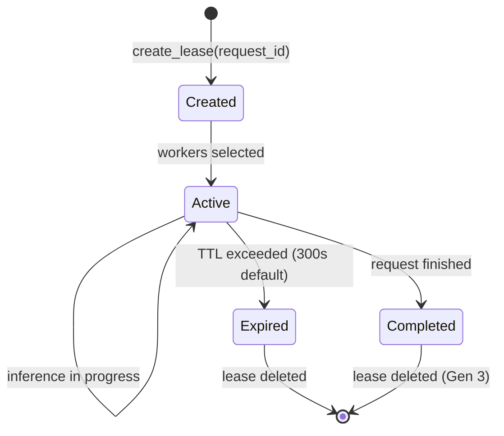
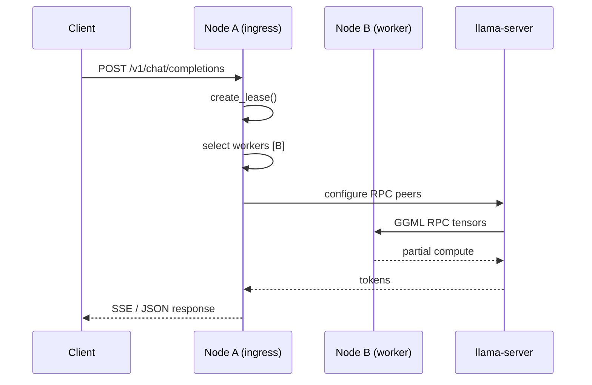

# 06 — Dynamic Request Coordinator

**Status:** Gen 2 implemented (`CoordinatorRegistry`)  
**SRS ID:** DAIOS-COORD-006

---

## Purpose

Specify ephemeral per-request coordination: lifecycle, responsibilities, ownership, recovery, concurrent coordinators, conflict prevention, and cluster consistency.

**Invariant:** No permanent master node. Coordination authority exists only for the duration of a single inference request (or lease TTL).

---

## Lifecycle



### Creation

```python
# apps/node/src/daios_node/coordinator.py
lease = CoordinatorLease(
    request_id=rid,                    # UUID or client X-Request-ID
    coordinator_node_id=self.config.node_id,
    coordinator_host=bind_host,
    worker_endpoints=["10.0.0.2:50052", ...],
    created_at=now,
    expires_at=now + timedelta(seconds=300),
)
```

Triggered when the node receiving `/v1/chat/completions` acts as request entry point.

---

## Responsibilities

| Responsibility | Owner |
|---|---|
| Worker selection | Coordinator node (greedy score Gen 2) |
| RPC peer configuration | `InferenceManager.set_peer_hosts()` |
| Lease tracking | `CoordinatorRegistry._leases` |
| Advertise active workload | Included in heartbeat `active_leases` |
| Request proxy to llama-server | `NodeApp` inference path |

The coordinator does **not** persist cluster state or arbitrate all cluster traffic.

---

## Election

**Gen 2: No election.** The ingress node is coordinator.

**Gen 3:** Optional scheduler may reassign coordination to a less loaded node before inference starts. Client still connects to any node; ingress forwards or redirects.



---

## Ownership

| Asset | Owner during lease |
|---|---|
| `request_id` | Creating coordinator |
| Worker RPC sessions | Coordinator's llama-server |
| Lease record | Coordinator's in-memory registry |
| Model weights | Workers hosting RPC servers |

Ownership transfers on lease expiry without migration (client must retry).

---

## Recovery

| Failure | Recovery |
|---|---|
| Coordinator crash | Lease lost; client timeout; retry any node |
| Worker crash mid-inference | llama-server error; coordinator may retry with new workers (Gen 3) |
| Lease TTL exceeded | `get_lease()` returns None; resources freed |
| Coordinator slow | Client-side timeout; new request → new coordinator |

Gen 3: lease checkpointing for multi-minute batch jobs.

---

## Migration (Gen 2 → Gen 3)

- `CoordinatorLease` schema unchanged
- Worker list source changes from local greedy to scheduler RPC
- `active_leases` in heartbeat enables scheduler-aware placement

---

## Concurrent Coordinators

Multiple nodes may simultaneously hold active leases for different `request_id` values.

**Conflict prevention:**

- `request_id` is unique per client request (UUID)
- Workers track inbound RPC by connection; no double-booking of same request
- `should_refuse_work()` prevents overloaded workers from selection

**Max workers per lease:** 4 endpoints (Gen 2 cap in `_select_workers`).

---

## Coordinator Communication

Gen 2: indirect via gossip only (active leases in heartbeat).

Gen 3 planned:

```
POST /internal/coordinator/handoff
{ "request_id", "from_node", "to_node", "worker_endpoints" }
```

---

## Request Completion

Gen 2:

1. Streaming response completes → lease remains until TTL (known limitation)
2. Gen 3: explicit `release_lease(request_id)` on response end

---

## Cluster Consistency

Coordinators do not require strong consistency. Requirements:

- **Worker view:** Eventually consistent via membership (alive/dead)
- **Placement:** Best-effort on snapshot at lease creation time
- **Split brain:** Two coordinators may briefly select same worker; GGML RPC handles serialization

---

## Scoring Algorithm (Gen 2)

```text
score_peer_for_placement(advertisement, rtt_ms):
    base = 1.0 - (cpu_percent / 100) * 0.3
    base -= (ram_pressure) * 0.2
    base -= (gpu_utilization / 100) * 0.3 if gpu
    base -= (rtt_ms / 1000) * 0.2
  return max(0, base)
```

Peers with `should_refuse_work() == true` are excluded.

---

## Configuration

```yaml
# Gen 3 planned
coordinator:
  lease_ttl_seconds: 300
  max_workers_per_lease: 4
  handoff_enabled: false
```

---

## Metrics (Gen 3)

- `daios_coordinator_leases_active`
- `daios_coordinator_lease_duration_seconds`
- `daios_coordinator_worker_selection_failures_total`

---

## Acceptance Criteria

- [x] Any node can create lease on incoming request
- [x] No distributed lock or master election
- [x] Dead workers excluded from selection
- [x] Active leases visible in `/membership` and heartbeats
- [ ] Explicit lease release on completion (Gen 3)
