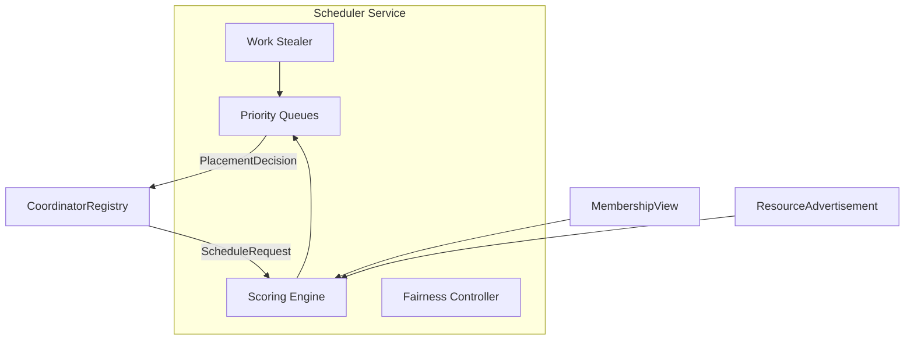

# 07 — Distributed Scheduler Specification

**Status:** Gen 3 design · Gen 2 uses greedy placement  
**SRS ID:** DAIOS-SCHED-007

---

## Purpose

Define the Generation 3 cluster-wide scheduler: algorithms for resource allocation, node scoring, fairness, latency optimization, work stealing, and backpressure. Gen 2 `CoordinatorRegistry._select_workers` is the baseline to replace.

---

## Architecture



Scheduler runs in-process per node (decentralized) with gossip-synchronized queue state — not a single scheduler master.

---

## ScheduleRequest / PlacementDecision

```yaml
# Gen 3 protocol extension
ScheduleRequest:
  request_id: string
  priority: interactive | background | batch
  model_id: string
  estimated_tokens: int
  tenant_id: string | null
  latency_slo_ms: int | null

PlacementDecision:
  request_id: string
  workers: [NodePlacement]
  scheduler_version: int
  score: float

NodePlacement:
  node_id: string
  rpc_endpoint: string
  layer_range: [int, int] | null   # Gen 4 tensor split
```

---

## Algorithm 1: Node Scoring

**Purpose:** Rank alive workers for a given request.

```text
function score(node, request, membership):
    if node.status != ALIVE: return -INF
    if should_refuse_work(node.advertisement): return -INF

    s = 100.0
    s -= node.advertisement.cpu_percent * 0.4
    s -= ram_pressure(node) * 25.0
    s -= gpu_pressure(node) * 30.0
    s -= node.advertisement.rtt_ms[coordinator_id] * 0.1
    s -= node.advertisement.current_workload * 5.0

    if request.priority == interactive:
        s += idle_bonus(node) * 20.0
    if node.thermal_state == "throttling":
        s -= 50.0
    if node.battery_percent < 20:
        s -= 40.0

    return s
```

| Property | Value |
|---|---|
| Time complexity | O(n) per request, n = cluster size |
| Space | O(1) |
| Failure mode | Stale metrics → suboptimal placement; mitigated by heartbeat freshness |

---

## Algorithm 2: Weighted Fair Queueing

**Purpose:** Multi-tenant fairness across concurrent clients.

```text
function select_queue(queues, tenant_weights):
    for each tenant t:
        virtual_time[t] += request_size / weight[t]
    return tenant with minimum virtual_time
```

| Property | Value |
|---|---|
| Time complexity | O(t) tenants |
| Failure mode | Weight misconfiguration → starvation; monitor Jain's index |

---

## Algorithm 3: Interactive Prioritization

Two queues: `interactive` (priority 0) and `background` (priority 1).

```text
function dequeue():
    if interactive_queue not empty:
        return interactive_queue.pop()
    return background_queue.pop()
```

Preemption (Gen 3.1): background tasks yield RPC slots when interactive queue depth > 0.

---

## Algorithm 4: Work Stealing

```text
function steal_loop(node):
    if node.idle and node.advertisement.current_workload == 0:
        victim = argmax(peer.advertisement.current_workload)
        if victim.workload > STEAL_THRESHOLD:
            task = request_transfer(victim, node)
            if task: execute(task)
```

| Property | Value |
|---|---|
| Time complexity | O(n) per steal attempt |
| Interval | Every `scheduler.steal_interval` (default 2s) |
| Failure mode | Duplicate execution; prevented by request_id lease |

---

## Algorithm 5: Memory Balancing

Prefer workers with sufficient VRAM for model:

```text
function vram_fit(node, model_vram_gb):
    available = node.gpu.vram_total_gb - node.gpu.vram_used_gb
    return available >= model_vram_gb * 1.1
```

Filter before scoring; hard reject if fit fails.

---

## Algorithm 6: Backpressure

```text
function admit(request, cluster):
    if cluster.queue_depth > MAX_QUEUE_DEPTH:
        return REJECT_503
    if all peers should_refuse_work():
        return REJECT_503
    return ADMIT
```

Coordinator propagates `Retry-After` header to clients.

---

## Algorithm 7: Latency-Aware Placement

For `latency_slo_ms` requests:

```text
function latency_aware_select(candidates, slo):
    ranked = sort_by(rtt_ms + estimated_compute_latency)
  return first where total_latency < slo * 0.8
```

If none meet SLO, return best-effort with warning header `X-DAIOS-SLO-Warning`.

---

## Configuration (Gen 3)

```yaml
scheduler:
  enabled: true
  steal_interval: 2.0
  max_queue_depth: 100
  interactive_weight: 4.0
  background_weight: 1.0
  default_tenant_weight: 1.0
```

---

## Failure Analysis Summary

| Algorithm | Failure | Impact | Mitigation |
|---|---|---|---|
| Scoring | Stale RTT | Slow placement | Decay RTT; cap age |
| WFQ | Single heavy tenant | Queue growth | Per-tenant depth limit |
| Work stealing | Network partition | Duplicate risk | Lease + idempotency |
| Backpressure | False reject | Lower utilization | Hysteresis on depth |

---

## Migration from Gen 2

1. Deploy with `scheduler.enabled: false` (greedy fallback)
2. Enable on canary nodes; compare placement logs
3. Enable cluster-wide when Jain's index ≥ 0.85 in shadow mode

---

## Performance Targets

| Cluster size | Scheduling decision P99 |
|---|---|
| 2–8 | < 5ms |
| 16–32 | < 15ms |
| 64–128 | < 50ms |
| 1024 | < 200ms (hierarchical regions) |

---

## Acceptance Criteria (Gen 3)

- [ ] Scheduler enabled via feature flag
- [ ] Greedy fallback when `scheduler.enabled: false`
- [ ] No starvation under 10-tenant mixed load
- [ ] Work stealing improves utilization ≥ 10% on skewed workloads
