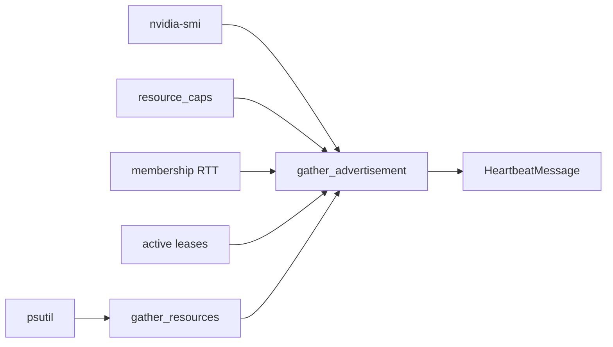

# 08 — Resource Contribution System

**Status:** Gen 2 implemented (`resources.py`)  
**SRS ID:** DAIOS-RES-008

---

## Purpose

Define how nodes advertise resources, how much work they accept, when they refuse work, and how to protect interactive local workloads while maximizing cluster utilization.

---

## Advertised Fields

`ResourceAdvertisement` (from `packages/protocol/health.py`):

| Field | Source | Gen |
|---|---|---|
| `cpu_percent` | `psutil.cpu_percent()` | 2 |
| `cpu_available_cores` | logical count × headroom | 2 |
| `ram_total_gb` / `ram_available_gb` | `psutil.virtual_memory()` | 2 |
| `gpu` | `nvidia-smi` subprocess | 2 |
| `disk_free_gb` | `shutil.disk_usage()` | 2 |
| `bandwidth_mbps` | Static config / future probe | 3 |
| `rtt_ms` | Per-peer heartbeat RTT map | 2 |
| `thermal_state` | Platform API (stub) | 3 |
| `battery_percent` | `psutil.sensors_battery()` | 2 |
| `user_idle_seconds` | Platform idle detection (partial) | 3 |
| `configured_caps` | `ResourceCapsConfig` | 2 |
| `current_workload` | Active coordinator leases | 2 |
| `timestamp` | UTC now | 2 |

---

## Gathering Pipeline



---

## Configured Limits

```yaml
resource_caps:
  max_cpu_percent: 80      # refuse remote work above local 80% CPU
  max_ram_gb: 32           # cap contributed RAM
  max_gpu_percent: 90      # GPU utilization ceiling
```

Stored in `advertisement.configured_caps` for remote visibility.

---

## Algorithm: should_refuse_work

**Purpose:** Worker signals it cannot accept new remote placements.

```text
function should_refuse_work(advertisement, local_caps):
    if advertisement.cpu_percent > local_caps.max_cpu_percent:
        return true
    if advertisement.ram_available_gb < RESERVED_RAM_GB:
        return true
    if advertisement.gpu.utilization_percent > local_caps.max_gpu_percent:
        return true
    if advertisement.battery_percent < 15:
        return true
    if advertisement.current_workload >= MAX_CONCURRENT_REMOTE:
        return true
    return false
```

| Complexity | O(1) |
| Failure mode | False refuse → underutilization; false accept → local lag |

`RESERVED_RAM_GB` default: 4.0 GB for OS/interactive.

---

## Algorithm: score_peer_for_placement

**Purpose:** Coordinator ranks workers (higher = better).

```text
function score_peer_for_placement(ad, rtt_ms):
    score = 1.0
    score -= (ad.cpu_percent / 100) * 0.25
    score -= ram_pressure(ad) * 0.25
    if ad.gpu:
        score -= (ad.gpu.utilization_percent / 100) * 0.25
    score -= min(rtt_ms, 500) / 500 * 0.25
    return max(0.01, score)
```

Used by `CoordinatorRegistry._select_workers`; top 4 endpoints selected.

---

## Algorithm: Local Contribution Bias

**Purpose:** Requesting node should contribute its own resources when beneficial.

Gen 2: if no remote workers qualify, fallback to `127.0.0.1:rpc_port`.

Gen 3:

```text
function include_local(coordinator, members, request):
    local_score = score(coordinator.local_ad, request)
    best_remote = max(score(m) for m in members)
    if local_score > best_remote * 0.9:
        include local RPC in worker_endpoints
```

Prevents unnecessary network hop when coordinator has capable GPU.

---

## Algorithm: Interactive Protection

When local user is active (`user_idle_seconds < 60`):

```text
function effective_caps(config_caps, advertisement):
    if advertisement.user_idle_seconds < 60:
        return tighten(config_caps, factor=0.5)
    return config_caps
```

Dashboard slider (Gen 5) sets `max_cpu_percent` / `max_gpu_percent` live.

---

## Algorithm: Cluster Utilization Maximization

Gen 3 scheduler loop:

```text
function rebalance(cluster):
    overloaded = [n for n in cluster if n.cpu_percent > 85]
    underloaded = [n for n in cluster if n.cpu_percent < 40 and not should_refuse_work(n)]
    for o in overloaded:
        steal_work(o, underloaded)
```

---

## Refusal Propagation

1. Worker sets high utilization → `should_refuse_work` true
2. Excluded from `_select_workers` candidates
3. Heartbeat still sent (node remains cluster member)
4. Dashboard shows "not accepting work" badge

---

## API Exposure

| Endpoint | Field |
|---|---|
| `GET /health` | `resources: ResourceUsage` |
| `GET /membership` | per-member `advertisement` |
| `GET /cluster` | `local_resources`, peer resources |

---

## Future: Bandwidth Probing

Gen 3 periodic iperf-style probe between peers:

```text
bandwidth_mbps[peer_id] = exponential_moving_average(probe_results)
```

Used in WAN placement decisions.

---

## Acceptance Criteria

- [x] Live CPU/RAM in heartbeat
- [x] GPU when nvidia-smi available
- [x] Configured caps enforced in placement
- [x] Refuse work when over cap
- [ ] User idle detection accurate on Linux/macOS/Windows (Gen 3)
- [ ] Bandwidth probing (Gen 3)
