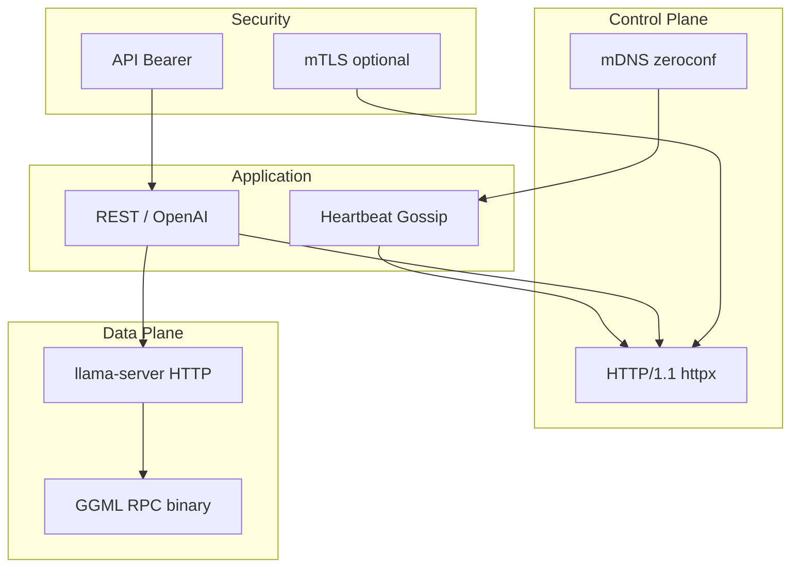

# 09 — Networking Specification

**Status:** Gen 2 HTTP + mDNS implemented  
**SRS ID:** DAIOS-NET-009

---

## Purpose

Specify discovery, peer connections, transports, serialization, encryption, retries, heartbeats, NAT traversal, and LAN/WAN optimization for DAIOS inter-node communication.

---

## Layer Model



---

## Discovery

### mDNS (Gen 2 — implemented)

| Property | Value |
|---|---|
| Service type | `_daios._tcp.local.` |
| TXT keys | `node_id`, `role`, `api_port`, `rpc_port`, `cluster_name` |
| Library | `zeroconf` |
| Interval | `discovery.advertise_interval` (5s) |

### Static Seeds (Gen 3 — planned)

```yaml
discovery:
  enabled: true
  mdns: false
  seeds:
    - host: 10.0.0.1
      api_port: 8000
```

### Bootstrap Gateway (Gen 5)

Federation nodes expose `/_daios/bootstrap` for cross-network peer exchange.

---

## Peer Connections

| Connection | Protocol | Port | Auth |
|---|---|---|---|
| Node API | HTTP | `network.api_port` | API token |
| Heartbeat | HTTP POST | `/internal/heartbeat` | mTLS optional |
| GGML RPC | TCP binary | `network.rpc_port` | None (LAN) |
| llama-server | HTTP | `inference.llama_server_port` | Localhost |

Connection pooling: `httpx.AsyncClient` singleton per node (timeout 120s).

---

## gRPC / QUIC (Gen 3+)

| Transport | Use case | Status |
|---|---|---|
| gRPC | Control plane replacement | Planned |
| QUIC | WAN with NAT traversal | Gen 4 research |
| WebSockets | Dashboard push | Gen 3 |

Protobuf definitions will live in `packages/protocol/proto/`.

---

## Binary Protocol

**GGML RPC:** Opaque to DAIOS; managed by llama.cpp. DAIOS configures peer host list only.

**DAIOS wire messages (Gen 2):** JSON over HTTP via Pydantic serialization.

Gen 3 option: MessagePack for heartbeat payloads > 8KB.

---

## Streaming

| Path | Mechanism |
|---|---|
| OpenAI chat | SSE from llama-server proxied through FastAPI `StreamingResponse` |
| Logs | Dashboard polls launcher API |
| Gen 3 metrics | WebSocket `/ws/events` |

---

## Serialization

- Config: YAML on disk → Pydantic models
- API: JSON (`application/json`)
- Future: `packages/serialization` for compact gossip

---

## Compression

| Layer | Gen | Method |
|---|---|---|
| HTTP | 2 | gzip for large responses (optional) |
| Model transfer | 4 | zstd in `packages/compression` |
| RPC tensors | 4 | Quantized activations (research) |

---

## Encryption

```yaml
security:
  mtls_enabled: true
  ca_cert: /path/ca.pem
  node_cert: /path/node.pem
  node_key: /path/node.key
  auto_generate_certs: true   # dev only
```

`ensure_dev_certs()` writes to `~/.daios/certs/{node_id}/`.

Inter-node `httpx` client uses SSL context when mTLS enabled.

---

## Retries

| Operation | Policy |
|---|---|
| Heartbeat | No retry; next interval |
| Chat completion | Client retry with new request_id |
| Peer probe (Gen 1) | Single attempt per poll |

Gen 3: exponential backoff for scheduler RPC (max 3 attempts).

---

## Heartbeat

- Interval: `membership.heartbeat_interval` (5s)
- Payload: `HeartbeatMessage` + `HeartbeatResponse`
- RTT: measured round-trip stored in `rtt_ms` dict

---

## Failure Detection

```text
if now - member.last_seen > failure_timeout / 2:
    status = SUSPECT
if now - member.last_seen > failure_timeout:
    status = DEAD
```

Default `failure_timeout`: 15s.

---

## Flow Control

Gen 2: implicit via `should_refuse_work` and max 4 workers per lease.

Gen 3: scheduler backpressure with `MAX_QUEUE_DEPTH`.

GGML RPC: backpressure handled by llama.cpp (blocking RPC).

---

## NAT Traversal

| Scenario | Gen 2 | Gen 3+ |
|---|---|---|
| Same LAN | mDNS | mDNS |
| Different subnets | Manual peer IP | STUN + seed broker |
| Internet | Not supported | QUIC + TURN relay (Gen 5) |

---

## Firewall Handling

Required open ports per node:

- TCP `api_port` (default 8000) — API + gossip
- TCP `rpc_port` (default 50052) — GGML RPC
- UDP 5353 — mDNS (if discovery enabled)

Document in Operations Guide: `deploy/FIREWALL.md` (future).

---

## VPN Support

DAIOS is VPN-transparent: use VPN-assigned IPs in manual peers or ensure mDNS reflection across VPN (often blocked — prefer static seeds on VPN).

---

## LAN vs WAN Optimization

| Optimization | LAN | WAN |
|---|---|---|
| Worker selection | Low RTT weight | Bandwidth + RTT |
| Model location | Local disk | Replicate hot models (Gen 4) |
| RPC cache | `rpc_cache: true` | Disabled (stale risk) |
| Tensor split | Aggressive | Conservative |

---

## Acceptance Criteria

- [x] mDNS discovery on same broadcast domain
- [x] Heartbeat gossip over HTTP
- [x] Optional mTLS for HTTP
- [x] GGML RPC peer list synced from membership
- [ ] gRPC control plane (Gen 3)
- [ ] NAT traversal (Gen 5)
