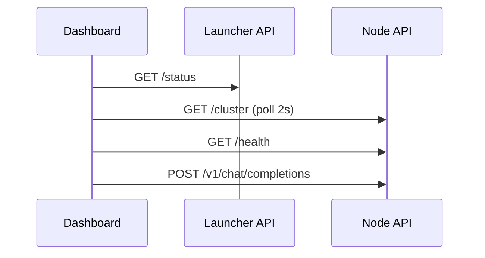

# 10 — API Specifications

**Status:** Gen 2 implemented  
**SRS ID:** DAIOS-API-010  
**Base URL:** `http://{host}:{api_port}`

---

## Authentication

| Method | Header | Config |
|---|---|---|
| Bearer token | `Authorization: Bearer <token>` | `security.api_token` |
| mTLS | Client cert | `security.mtls_enabled` |

When `api_token` is set, all routes except `/health` (optional bypass) require Bearer token.

**401:** Missing or invalid token.  
**403:** Valid token but insufficient scope (Gen 5 RBAC).

---

## Public Endpoints

### GET /health

**Purpose:** Node liveness and inference subprocess state.

**Response:** `NodeHealth`

```json
{
  "node_id": "worker-1",
  "role": "hybrid",
  "status": "ok",
  "inference": {
    "backend": "llama.cpp",
    "llama_server": "running",
    "rpc_server": "running",
    "model_path": "/models/model.gguf"
  },
  "uptime_seconds": 3600.5,
  "resources": { "cpu_percent": 12.5, "ram_percent": 45.0 }
}
```

| Property | Value |
|---|---|
| Auth | Optional (public for load balancers) |
| Timeout | 5s |
| Retry | Client retry 3× |

---

### GET /cluster

**Purpose:** Cluster view (Gen 1 peers or Gen 2 membership).

**Response:** `ClusterStatus`

```json
{
  "generation": 2,
  "peers": [],
  "rpc_endpoints": ["10.0.0.2:50052"],
  "membership": {
    "local_node_id": "coord-1",
    "members": [],
    "generation": 2,
    "membership_version": 3
  }
}
```

---

### GET /membership

**Purpose:** Gen 2 membership view only.

**Response:** `MembershipView`  
**Auth:** Required if api_token set.

---

### POST /v1/chat/completions

**Purpose:** OpenAI-compatible chat inference (proxied to llama-server).

**Request:**

```json
{
  "model": "local-model",
  "messages": [{"role": "user", "content": "Hello"}],
  "stream": true
}
```

**Response:** OpenAI JSON or SSE stream.

| Property | Value |
|---|---|
| Auth | Required if api_token set |
| Timeout | 120s (client); streaming unbounded |
| Retry | New request on different node after timeout |
| Versioning | OpenAI API v1 compatible |

**Coordinator side effect:** Creates ephemeral lease on ingress node.

---

### POST /v1/completions

**Purpose:** Legacy completions API (if llama-server supports).

Same auth/timeout as chat.

---

## Internal Endpoints (Gen 2)

### POST /internal/heartbeat

**Request:** `HeartbeatMessage`  
**Response:** `HeartbeatResponse`  
**Auth:** mTLS when enabled; cluster trust zone.

```json
{
  "sender": { "node_id": "a", "host": "10.0.0.1", "api_port": 8000 },
  "membership_version": 2,
  "advertisement": { "cpu_percent": 20.0 },
  "active_leases": []
}
```

---

### POST /internal/leave

**Request:** `LeaveMessage`

```json
{ "node_id": "worker-1", "membership_version": 5 }
```

---

## Launcher API (Development)

Base: `http://localhost:9000` (launcher default)

| Method | Path | Purpose |
|---|---|---|
| GET | `/status` | Running node processes |
| POST | `/start` | Spawn node from config path |
| POST | `/stop` | Stop node by id |
| GET | `/logs/{node_id}` | Tail logs |

Used by `apps/dashboard/src/api/launcher.ts`.

---

## Dashboard Consumption



---

## Error Format

```json
{
  "detail": "Human-readable message"
}
```

| Code | Meaning |
|---|---|
| 400 | Validation error |
| 401 | Unauthorized |
| 404 | Lease or resource not found |
| 503 | No workers available (Gen 3 backpressure) |
| 504 | Inference timeout |

---

## Versioning

- FastAPI app version: `0.2.0`
- `ClusterStatus.generation` / `MembershipView.generation`: protocol generation (1 or 2)
- OpenAI API: unversioned path `/v1/` for client compatibility

**Migration:** New fields added as optional; clients ignore unknown fields.

---

## Rate Limiting (Gen 3)

```
X-RateLimit-Limit: 100
X-RateLimit-Remaining: 95
Retry-After: 60
```

Per-node token bucket; configurable `api.rate_limit_rpm`.

---

## SDK Surface (Planned)

All public endpoints generated into `sdk/python/daios/client.py` from OpenAPI spec.

---

## Acceptance Criteria

- [x] OpenAI chat completions proxy
- [x] Health and cluster endpoints
- [x] Internal heartbeat/leave
- [x] Bearer token middleware
- [ ] OpenAPI spec published to `docs/api/openapi.yaml` (Gen 3)
- [ ] Rate limiting (Gen 3)
