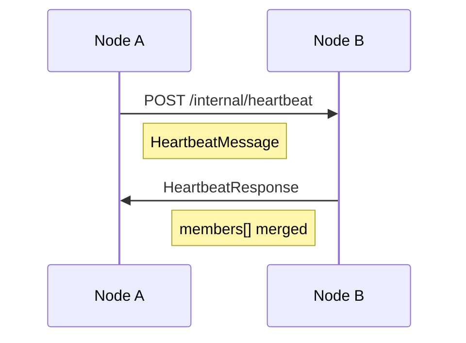

# 11 — Protocol Definitions

**Status:** Gen 2 implemented in `packages/protocol`  
**SRS ID:** DAIOS-PROTO-011

---

## Purpose

Define wire protocol message types, configuration schemas, health models, and version negotiation for DAIOS peer communication.

**Source of truth:** `packages/protocol/src/daios_protocol/`

---

## Package Structure

```
packages/protocol/
├── src/daios_protocol/
│   ├── __init__.py
│   ├── config.py      # NodeConfig and nested models
│   ├── health.py      # Cluster and resource types
│   └── messages.py    # Gossip wire messages
└── pyproject.toml
```

All models are Pydantic v2 `BaseModel` for JSON serialization.

---

## Configuration Schema (`config.py`)

### NodeConfig (root)

| Field | Type | Default | Gen |
|---|---|---|---|
| `node_id` | string | required | 1 |
| `role` | `coordinator\|worker\|hybrid` | `hybrid` | 1 |
| `network` | `NetworkConfig` | — | 1 |
| `peers` | `list[PeerConfig]` | `[]` | 1 |
| `discovery` | `DiscoveryConfig` | `enabled=false` | 2 |
| `security` | `SecurityConfig` | — | 2 |
| `membership` | `MembershipConfig` | — | 2 |
| `resource_caps` | `ResourceCapsConfig` | — | 2 |
| `inference` | `InferenceConfig` | — | 1 |

### DiscoveryConfig

```yaml
discovery:
  enabled: false
  mdns: true
  cluster_name: daios
  advertise_interval: 5.0
  listen_port: null
```

### SecurityConfig

```yaml
security:
  mtls_enabled: false
  ca_cert: null
  node_cert: null
  node_key: null
  api_token: null
  auto_generate_certs: true
```

---

## Health Types (`health.py`)

### MemberStatus

`alive | suspect | dead | leaving`

### ResourceAdvertisement

Full resource snapshot for gossip (see `08-resource-contribution.md`).

### MemberInfo

```yaml
node_id: string
host: string
api_port: int
rpc_port: int
role: string
status: MemberStatus
last_seen: datetime
resources: ResourceUsage | null
advertisement: ResourceAdvertisement | null
membership_version: int
```

### CoordinatorLease

```yaml
request_id: string
coordinator_node_id: string
coordinator_host: string
worker_endpoints: [string]
created_at: datetime
expires_at: datetime
```

### MembershipView

```yaml
local_node_id: string
members: [MemberInfo]
generation: 2
membership_version: int
active_leases: [CoordinatorLease]
cluster_name: string | null
```

---

## Wire Messages (`messages.py`)

### HeartbeatMessage



| Field | Type | Description |
|---|---|---|
| `sender` | MemberInfo | Full sender state |
| `membership_version` | int | Sender's view version |
| `advertisement` | ResourceAdvertisement | Optional override |
| `active_leases` | CoordinatorLease[] | Coordinator workload |

### HeartbeatResponse

| Field | Type |
|---|---|
| `sender` | MemberInfo |
| `membership_version` | int |
| `members` | MemberInfo[] |

### LeaveMessage

| Field | Type |
|---|---|
| `node_id` | string |
| `membership_version` | int |

---

## Version Negotiation

| Field | Location | Meaning |
|---|---|---|
| `MembershipView.generation` | API response | Protocol generation (2) |
| `ClusterStatus.generation` | API response | 1 if manual peers only |
| FastAPI `version` | OpenAPI | App release (0.2.0) |

**Rule:** Nodes with mismatched `generation` may gossip but must not assume unknown fields.

Future `ProtocolHello`:

```yaml
min_generation: 2
max_generation: 3
capabilities: [scheduler, mtls]
```

---

## Merge Semantics

On heartbeat receive:

```text
for m in response.members:
    if m.node_id == local: skip
    existing = members[m.node_id]
    if existing is None or m.membership_version >= existing.membership_version:
        members[m.node_id] = m
```

Last-writer-wins on `membership_version` per node entry.

---

## Serialization Format

- **On wire:** JSON (`Content-Type: application/json`)
- **On disk:** YAML config files
- **Future:** MessagePack for gossip (`Accept: application/msgpack`)

---

## mDNS TXT Protocol

| Key | Example | Required |
|---|---|---|
| `node_id` | `worker-mdns` | yes |
| `role` | `hybrid` | yes |
| `api_port` | `8000` | yes |
| `rpc_port` | `50052` | yes |
| `cluster_name` | `daios-home` | no |

---

## Gen 3 Extensions (Planned)

New file: `packages/protocol/messages_scheduler.py`

- `ScheduleRequest`
- `PlacementDecision`
- `StealRequest`

Registered in `ProtocolHello.capabilities`.

---

## Compatibility Matrix

| Client Gen | Server Gen | Behavior |
|---|---|---|
| 1 | 2 | Works; `membership` null |
| 2 | 1 | Works; discovery disabled on server |
| 2 | 2 | Full gossip |
| 3 | 2 | Scheduler calls fail; fallback greedy |

---

## Acceptance Criteria

- [x] Pydantic models for all Gen 2 types
- [x] JSON round-trip in tests
- [x] YAML config load via `NodeConfig.from_yaml()`
- [ ] Protobuf codegen (Gen 3)
- [ ] ProtocolHello handshake (Gen 3)
