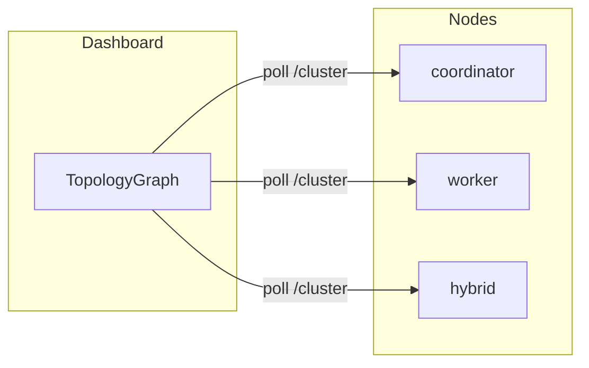

# 13 — Dashboard & Desktop Specification

**Status:** Dashboard Gen 2 implemented · Desktop Gen 5 planned  
**SRS ID:** DAIOS-UI-013

---

## Purpose

Specify the web dashboard (implemented) and native desktop application (planned) for cluster management, visualization, and inference interaction.

---

## Dashboard (`apps/dashboard`)

**Stack:** React 18, TypeScript, Vite, Tailwind CSS.

### Implemented Components

| Component | File | Function |
|---|---|---|
| TopologyGraph | `TopologyGraph.tsx` | Visual cluster graph |
| LiveStatus | `LiveStatus.tsx` | Node health polling |
| ResourcePanel | `ResourcePanel.tsx` | CPU/RAM/GPU display |
| ConnectCoordinator | `ConnectCoordinator.tsx` | Launcher connection |
| ConnectWorker | `ConnectWorker.tsx` | Worker attach |
| ChatBot | `ChatBot.tsx` | OpenAI chat UI |
| LogPanel | `LogPanel.tsx` | Launcher log tail |
| LiveTabBar | `LiveTabBar.tsx` | Multi-node tabs |

### Cluster Overview

- Poll `GET /cluster` every 2s per connected node
- Display `generation`, peer count, membership version
- Show coordinator IP when detected via ping

### Node Details

- `GET /health` per node: inference state, uptime, model path
- Resource bars from `resources` field
- Model usage: `idle | active | offline`

### Coordinator Visualization

- Parse `membership.active_leases` when `generation >= 2`
- Highlight coordinator node and worker endpoints on topology graph
- Edge labels: RPC port

### Live Topology

Nodes rendered as circles; color by `MemberStatus` (alive=green, suspect=yellow, dead=red).

### Resources Panel

- Local and peer `ResourceAdvertisement` when Gen 2
- GPU VRAM bar when `gpu` present

### Inference / Chat

- `POST /v1/chat/completions` with `stream: true`
- SSE token rendering in ChatBot
- Model name from node health

### Logs

- Launcher API `GET /logs/{node_id}` for subprocess output
- Auto-scroll with pause toggle

### Metrics & Health

- Gen 2: derived from `/health` and `/membership`
- Gen 3: dedicated `/metrics` Prometheus scrape → dashboard charts

### Settings (Planned)

- API base URL and bearer token
- Poll interval
- Theme (light/dark)

---

## Dashboard API Dependencies

| API | Source |
|---|---|
| Node REST | `http://{host}:{api_port}` |
| Launcher | `http://localhost:9000` (dev) |

Types defined in `apps/dashboard/src/types.ts` mirroring `packages/protocol`.

---

## Desktop Application (Gen 5)

**Target:** Tauri 2.x (Rust shell + WebView hosting dashboard components).

### Cluster Join

- Wizard: name cluster, choose `discovery` or manual seed
- Writes config to `~/.daios/config.yaml`
- Spawns or connects to local `daios-node`

### Resource Contribution Controls

- Sliders bound to `resource_caps.max_cpu_percent`, `max_gpu_percent`
- Live PATCH to node config API (Gen 5)
- "Pause contributing" toggle → refuse all remote work

### Model Deployment

- Browse local GGUF files
- Set `inference.model_path` via UI
- Trigger inference restart

### Logs & Diagnostics

- Embedded LogPanel
- Export diagnostic bundle (config redacted, logs, `/health` snapshot)

### Updates

- Check signed release channel
- Background download + restart prompt

### Network Configuration

- Firewall port checklist
- VPN detection hint
- Test mDNS button

### Notifications

- OS notifications: peer joined/left, inference complete, thermal throttle

### Topology Graph

- Reuse `TopologyGraph` in WebView
- Full-screen mode with zoom/pan

---

## Desktop vs Dashboard Feature Matrix

| Feature | Dashboard | Desktop |
|---|---|---|
| Cluster overview | ✓ | ✓ |
| Chat inference | ✓ | ✓ |
| Resource sliders | — | Gen 5 |
| System tray | — | Gen 5 |
| Auto-start node | — | Gen 5 |
| Launcher integration | ✓ dev | — |

---

## Accessibility & UX

- Keyboard navigation for chat input
- Color-blind safe status colors (shape + color)
- Responsive layout for 1280px+ (dashboard)

---

## Acceptance Criteria

### Dashboard (Gen 2)

- [x] Topology graph with multiple nodes
- [x] Resource panel with live data
- [x] Chat with streaming
- [x] Log panel via launcher
- [x] Membership view when generation=2

### Desktop (Gen 5)

- [ ] Tauri shell boots local node
- [ ] Resource contribution sliders
- [ ] Signed auto-update
- [ ] System tray quick status
