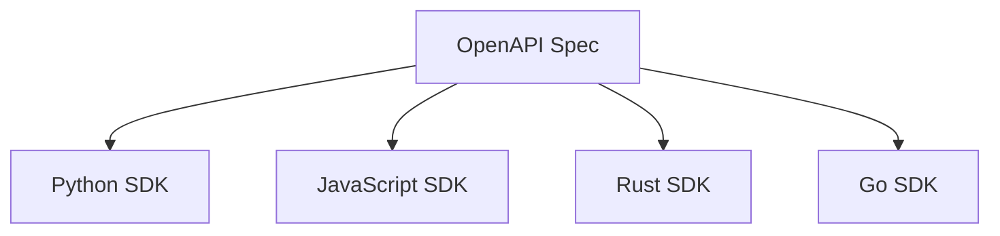

# 14 — CLI & SDK Specification

**Status:** Launcher implemented · Full CLI and SDKs planned  
**SRS ID:** DAIOS-CLI-014

---

## Purpose

Specify the `daios` command-line interface and multi-language SDKs for cluster operations, inference, and configuration.

---

## Current State

| Tool | Package | Status |
|---|---|---|
| `daios-node` | `apps/node` | Production |
| `daios-launcher` | `apps/launcher` | Dev only |

Full `daios` CLI unified binary is Gen 3+ deliverable.

---

## CLI Command Tree (Target)

```
daios
├── cluster
│   ├── status
│   ├── members
│   └── topology
├── node
│   ├── start
│   ├── stop
│   ├── health
│   └── logs
├── resource
│   ├── show
│   └── caps set
├── model
│   ├── list
│   └── load
├── scheduler
│   ├── queue
│   └── stats
├── metrics
├── plugins
│   ├── list
│   └── install
├── config
│   ├── show
│   ├── validate
│   └── migrate
├── update
├── repair
└── benchmark
```

---

## Command Specifications

### `daios cluster status`

**Example:**
```bash
daios cluster status --api http://10.0.0.1:8000 --token $DAIOS_API_TOKEN
```

**Expected output:**
```
Cluster: daios-home (generation 2)
Members: 3 alive, 0 suspect, 0 dead
Membership version: 12
Active leases: 1
Coordinator nodes: worker-1 (request abc-123)
```

---

### `daios node start`

```bash
daios node start --config /etc/daios/worker.yaml --daemon
```

Spawns `daios-node` subprocess; writes PID file to `~/.daios/run/{node_id}.pid`.

---

### `daios node health`

```bash
daios node health --api http://127.0.0.1:8000
```

```
node_id: worker-1
status: ok
inference.llama_server: running
uptime: 2h 15m
cpu: 23.5%
ram: 12.1 / 32.0 GB
```

---

### `daios resource caps set`

```bash
daios resource caps set --max-cpu 70 --max-gpu 80 --api http://127.0.0.1:8000
```

Gen 5: live config PATCH. Gen 3: edits YAML + restart.

---

### `daios model load`

```bash
daios model load --path /models/llama.gguf --api http://127.0.0.1:8000
```

Triggers inference manager reload (Gen 3 API).

---

### `daios benchmark`

```bash
daios benchmark run --nodes 2 --model /models/test.gguf --prompt-tokens 128
```

Runs tokens/sec harness; outputs JSON for CI regression.

---

### `daios config validate`

```bash
daios config validate --config worker.yaml
```

Uses Pydantic `NodeConfig` validation; exit 0 on success.

---

### `daios repair`

```bash
daios repair cluster --api http://127.0.0.1:8000
```

Checks: peer reachability, cert expiry, inference process state; suggests fixes.

---

## Global Flags

| Flag | Description |
|---|---|
| `--api` | Node API base URL |
| `--token` | Bearer token (or `DAIOS_API_TOKEN` env) |
| `--output json\|table` | Format |
| `--timeout` | Request timeout seconds |

---

## SDK Architecture



Generated clients + hand-written streaming helpers.

---

## SDK Modules (All Languages)

| Module | Methods |
|---|---|
| `Inference` | `chat.completions.create`, `stream` |
| `Streaming` | SSE iterator, cancel |
| `Cluster` | `status`, `members` |
| `Models` | `list`, `load` |
| `Resources` | `get`, `set_caps` |
| `Scheduling` | `schedule`, `queue` (Gen 3) |
| `Metrics` | `prometheus`, `health` |
| `Config` | `load`, `validate` |
| `Auth` | `token`, `mtls` |

---

## Python SDK Example (Target)

```python
from daios import Client

client = Client(base_url="http://10.0.0.1:8000", token="secret")

# Inference
for chunk in client.chat.completions.stream(
    model="local",
    messages=[{"role": "user", "content": "Hello"}],
):
    print(chunk.choices[0].delta.content, end="")

# Cluster
view = client.cluster.members()
print(view.membership_version)
```

**Package:** `sdk/python/` → PyPI `daios-sdk`

---

## JavaScript SDK Example (Target)

```javascript
import { DaiosClient } from '@daios/sdk';

const client = new DaiosClient({ baseUrl: 'http://localhost:8000' });
const status = await client.cluster.status();
```

---

## Versioning

- SDK major version tracks API breaking changes
- `User-Agent: daios-sdk-python/0.3.0` on all requests
- Server ignores unknown SDK versions

---

## Delivery Priority

| SDK | Generation | Priority |
|---|---|---|
| Python | Gen 3 | P0 |
| JavaScript | Gen 5 | P1 |
| Rust | Gen 5 | P2 |
| Go | Gen 5 | P3 |

---

## Acceptance Criteria

- [x] `daios-node` and `daios-launcher` entry points
- [ ] Unified `daios` CLI (Gen 3)
- [ ] Python SDK with streaming (Gen 3)
- [ ] OpenAPI-driven codegen pipeline
- [ ] `daios config validate` using protocol package
