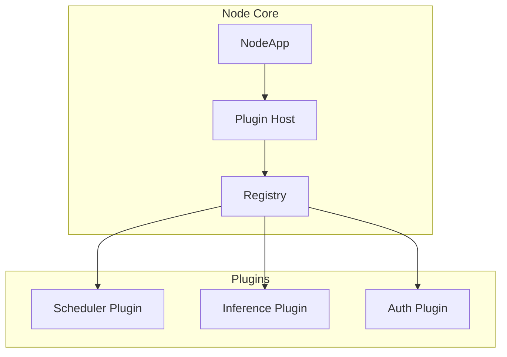

# 15 — Plugin Architecture

**Status:** Gen 5 design · extension points identified  
**SRS ID:** DAIOS-PLUGIN-015

---

## Purpose

Design an extension framework for schedulers, inference engines, model loaders, storage, authentication, compression, networking, telemetry, routing, and security — with installation, updates, hot loading, rollback, version compatibility, and sandboxing.

---

## Design Goals

1. **Stable core** — node lifecycle and protocol unchanged by plugins
2. **Replaceable backends** — inference and scheduler as primary targets
3. **Safe execution** — sandbox untrusted third-party plugins
4. **Versioned contracts** — semantic API for each extension point

---

## Extension Points

| Point | Interface | Gen | Example |
|---|---|---|---|
| Scheduler | `SchedulerPlugin` | 3 | Fair-share scheduler |
| Inference engine | `InferenceBackend` | 4 | `daios-native` tensors |
| Model loader | `ModelLoaderPlugin` | 4 | S3 GGUF pull |
| Storage | `StorageBackend` | 4 | NFS, MinIO |
| Authentication | `AuthProvider` | 5 | OIDC, LDAP |
| Compression | `Compressor` | 4 | zstd activations |
| Networking | `TransportPlugin` | 5 | QUIC transport |
| Telemetry | `TelemetryExporter` | 3 | OpenTelemetry |
| Routing | `RequestRouter` | 5 | Federation gateway |
| Security | `PolicyPlugin` | 5 | OPA policies |

---

## Plugin Manifest

```yaml
# plugin.yaml
name: fair-scheduler
version: 1.2.0
api_version: "0.1"
extension: scheduler
entrypoint: fair_scheduler:FairScheduler
dependencies:
  daios-protocol: ">=0.2.0"
capabilities:
  - work_stealing
  - multi_tenant
signature: base64-ed25519-sig
```

---

## Host Architecture



**Package:** `packages/plugins/` provides host SDK and loader.

---

## SchedulerPlugin Interface (Python)

```python
class SchedulerPlugin(Protocol):
    api_version: str = "0.1"

    def score(self, request: ScheduleRequest, members: list[MemberInfo]) -> list[NodePlacement]:
        ...

    def on_lease_released(self, request_id: str) -> None:
        ...
```

Default implementation: Gen 2 greedy scorer wrapped as built-in plugin.

---

## InferenceBackend Interface

```python
class InferenceBackend(Protocol):
    def start(self, config: InferenceConfig) -> None: ...
    def stop(self) -> None: ...
    def chat_completions(self, body: dict) -> AsyncIterator[bytes]: ...
    def status(self) -> InferenceStatus: ...
```

Built-in: `LlamaCppBackend`, `MockBackend` (existing).

---

## Installation

```bash
daios plugins install fair-scheduler-1.2.0.whl
```

1. Verify Ed25519 signature against trusted keys
2. Check `api_version` compatibility
3. Extract to `~/.daios/plugins/{name}/{version}/`
4. Register in node config:

```yaml
plugins:
  scheduler: fair-scheduler
  inference: llama.cpp
```

---

## Updates

```bash
daios plugins update fair-scheduler
```

- Download new version alongside old
- Atomic symlink swap on restart
- Gen 5.1: hot reload without restart for telemetry plugins only

---

## Hot Loading (Gen 5.1)

| Plugin type | Hot load | Requires restart |
|---|---|---|
| Telemetry | ✓ | — |
| Auth | — | ✓ |
| Scheduler | — | ✓ |
| Inference | — | ✓ |

---

## Rollback

```bash
daios plugins rollback fair-scheduler --to 1.1.0
```

Keeps previous version in `~/.daios/plugins/{name}/`; symlink revert.

---

## Version Compatibility

```
Host api_version 0.1 accepts plugins api_version 0.1.x
Host api_version 0.2 accepts 0.1.x and 0.2.x (adapter layer)
```

Incompatible plugin → install rejected with clear error.

---

## Sandboxing

| Tier | Mechanism | Use case |
|---|---|---|
| Trusted (signed) | In-process Python | Official DAIOS plugins |
| Community | WASM (wasmtime) | Marketplace plugins |
| Enterprise | Separate process + IPC | Custom inference |

WASM plugins receive capability tokens: `network:none`, `fs:models_readonly`.

---

## Marketplace (Gen 5)

- Registry API: `GET /marketplace/plugins`
- Models and plugins distributed as signed bundles
- Revenue share out of scope for engineering spec

---

## Migration from Built-in

Gen 2–4 built-ins ship as `plugins/builtin/`:

- `greedy_scheduler`
- `llama_cpp_inference`
- `psutil_resources`

No user action required; explicit plugins override defaults.

---

## Acceptance Criteria (Gen 5)

- [ ] Plugin manifest schema validated
- [ ] Signature verification on install
- [ ] Scheduler and inference extension points functional
- [ ] Rollback to previous plugin version
- [ ] WASM sandbox for untrusted plugins
