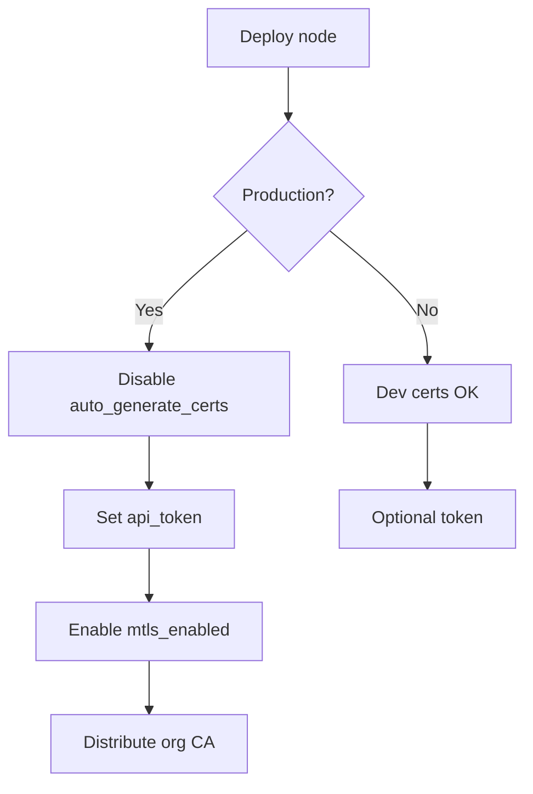

# 16 — Security Specification

**Status:** Gen 2 mTLS + API token implemented  
**SRS ID:** DAIOS-SEC-016

---

## Purpose

Specify TLS, mTLS, node identity, certificates, key rotation, JWT, RBAC, API keys, audit logging, secure updates, encrypted model transfer, and trusted peers for DAIOS.

---

## Threat Model

| Threat | Mitigation | Gen |
|---|---|---|
| Unauthorized API access | Bearer token | 2 |
| Man-in-the-middle (control plane) | mTLS | 2 |
| Rogue peer joining cluster | mTLS + trusted CA (Gen 5) | 2/5 |
| Token leakage | Env vars, file permissions | 2 |
| Model exfiltration | Encrypted transfer (Gen 4) | 4 |
| Malicious plugin | WASM sandbox (Gen 5) | 5 |
| Compromised update | Signed releases (Gen 5) | 5 |

**Assumption (Gen 2):** LAN is semi-trusted; GGML RPC is unencrypted on local network.

---

## TLS / mTLS (Gen 2)

### Configuration

```yaml
security:
  mtls_enabled: true
  ca_cert: ~/.daios/certs/worker-1/ca.pem
  node_cert: ~/.daios/certs/worker-1/node.pem
  node_key: ~/.daios/certs/worker-1/node.key
  auto_generate_certs: true
```

### Dev Certificate Generation

`ensure_dev_certs()` in `security.py`:

- RSA 2048 self-signed cert
- CN = `node_id`
- Validity: 365 days
- Stored in `~/.daios/certs/{node_id}/`

**Warning:** Auto-generated certs are for development only. Production must use org CA.

### HTTP Client SSL

```python
ssl_ctx = ssl.create_default_context(cafile=ca_cert)
ssl_ctx.load_cert_chain(node_cert, node_key)
httpx.AsyncClient(verify=ssl_ctx)
```

---

## API Token Authentication

```yaml
security:
  api_token: "${DAIOS_API_TOKEN}"
```

`ApiTokenMiddleware` validates:

```
Authorization: Bearer <api_token>
```

| Endpoint | Auth required |
|---|---|
| `/health` | Optional (configurable) |
| `/v1/*` | Yes when token set |
| `/internal/*` | mTLS when enabled |

**401** on mismatch; constant-time comparison via `secrets.compare_digest`.

---

## Node Identity

| Property | Source |
|---|---|
| Identity | `node_id` in config (must be unique cluster-wide) |
| Certificate CN | `node_id` |
| mDNS TXT | `node_id` advertisement |

Gen 5: UUID assigned at first boot, immutable in `~/.daios/identity`.

---

## Certificate Rotation

### Gen 2 (Manual)

1. Generate new cert with same CN
2. Distribute new CA if needed
3. Rolling restart nodes with new cert paths

### Gen 5 (Automated)

- Short-lived certs (24h) via internal CA
- Rotation 7 days before expiry
- `daios security rotate-certs` command

---

## JWT (Gen 5)

For multi-user dashboard and federation:

```json
{
  "sub": "user@org.com",
  "roles": ["inference", "admin"],
  "tenant_id": "team-a",
  "exp": 1735689600
}
```

Validated at API gateway; mapped to RBAC policies.

---

## RBAC (Gen 5)

| Role | Permissions |
|---|---|
| `viewer` | GET /health, /cluster, /membership |
| `inference` | + POST /v1/* |
| `operator` | + config read, metrics |
| `admin` | + config write, plugin install |

Enforced via middleware after JWT validation.

---

## API Keys

`api_token` is a static API key (Gen 2). Gen 5 adds:

- Scoped keys: `inference-only`, `read-only`
- Key rotation without downtime (dual-valid keys)
- Storage: `~/.daios/keys/` mode 0600

---

## Audit Logging (Gen 5)

```json
{
  "timestamp": "2026-06-30T12:00:00Z",
  "actor": "user@org.com",
  "action": "chat.completions",
  "node_id": "worker-1",
  "request_id": "abc-123",
  "result": "success"
}
```

Append-only log; optional forward to SIEM.

---

## Secure Updates (Gen 5)

- Release artifacts signed with Ed25519
- Public key embedded in desktop/CLI binary
- `daios update verify` before apply

---

## Encrypted Model Transfer (Gen 4)

- Models pulled over HTTPS/TLS from registry
- Optional at-rest encryption: AES-256-GCM per-chunk
- Key from tenant KMS

---

## Trusted Peers

### Gen 2

All peers in membership view are trusted for gossip. mTLS optional.

### Gen 5

```yaml
security:
  trusted_ca: /etc/daios/org-ca.pem
  require_client_cert: true
  peer_allowlist: []   # empty = any valid cert from CA
```

Nodes without valid client cert rejected at TLS handshake.

---

## Security Checklist



---

## Acceptance Criteria

- [x] API token middleware
- [x] Optional mTLS with dev cert generation
- [x] Constant-time token comparison
- [ ] Org CA documentation (Gen 3 ops guide)
- [ ] JWT + RBAC (Gen 5)
- [ ] Signed updates (Gen 5)
- [ ] GGML RPC TLS wrapper (Gen 4)
