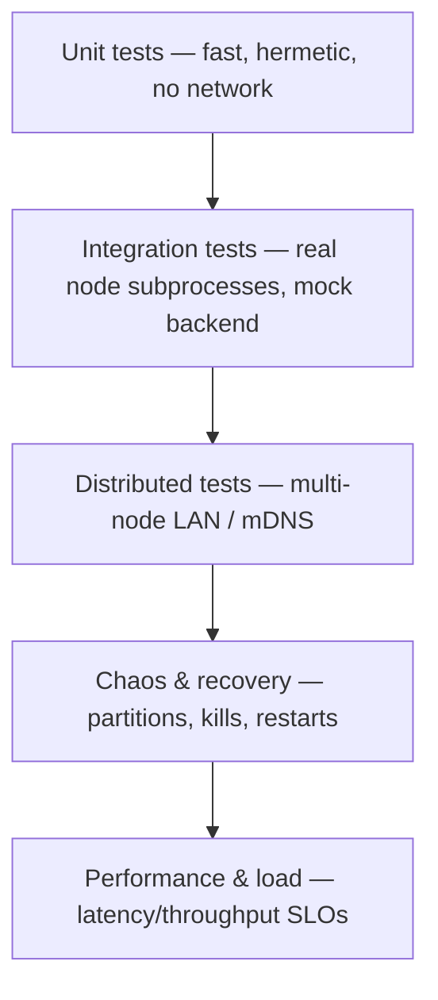

# 17 — Testing Strategy & Performance Targets

**Status:** Gen 1–2 unit + integration implemented · Gen 3–5 strategy specified  
**SRS ID:** DAIOS-QA-017

---

## Purpose

Define the test strategy (unit, integration, distributed, chaos, performance, load,
recovery, network-partition, compatibility, security) and measurable performance
targets for cluster sizes from 2 to 1024 nodes. This document is the QA contract
each generation must satisfy before sign-off.

---

## Test Pyramid



Lower layers run on every commit; upper layers run on tagged hardware or CI matrices.

---

## Test Categories

### 1. Unit tests (Gen 1–2 — implemented)

Hermetic, no sockets to external hosts, run under `pytest` with `asyncio_mode=auto`.

| Area | File |
|---|---|
| Config schema / role properties | `tests/test_config.py` |
| Resource advertisement & scoring | `tests/test_resources.py` |
| Model-usage accounting | `tests/test_model_usage.py` |
| GGUF context parsing (bad-file safe) | `tests/test_gguf_context.py` |
| Inference subprocess command build | `tests/test_inference.py` |
| Coordinator lease lifecycle | `tests/test_coordinator.py` |
| Gossip membership state machine | `tests/test_membership.py` |
| mDNS discovery records | `tests/test_discovery.py` |

### 2. Integration tests (Gen 1–2 — implemented)

Spawn real `daios-node` subprocesses (mock backend, no llama.cpp binaries) and
exercise the HTTP surface end-to-end.

| Area | File |
|---|---|
| Two-node mock cluster health/cluster/chat | `tests/test_integration.py` |
| Launcher control API + mock chat | `tests/test_launcher.py` |
| OpenAI proxy (stream + non-stream) | `tests/test_proxy.py` |
| Remote worker control proxy | `tests/test_worker_proxy.py` |
| Membership over loopback gossip | `tests/test_membership_integration.py` |

### 3. Compatibility tests (Gen 1–2 — implemented)

| Concern | Coverage |
|---|---|
| Cross-platform (Windows venv `Scripts`, `.exe`) | `tests/test_launcher_windows.py`; full suite verified green on Windows + Linux |
| Gen 1 YAML loads unchanged when discovery off | `tests/test_config.py`, `examples/two-node/*` |
| OpenAI client compatibility (Continue/Cursor) | `/v1/chat/completions` stream + non-stream contract |
| API version negotiation | See [12 — Migration Strategy](12-migration-strategy.md) |

### 4. Distributed tests (Gen 2 — partial; Gen 3 target)

Multi-host scenarios that loopback cannot fully exercise.

- Two physical/VM hosts over LAN — harness: `benchmarks/run_lan_benchmark.sh`.
- mDNS auto-join across hosts on the same subnet (`cluster_name: daios`).
- Heterogeneous CPU+GPU split via RPC — harness: `benchmarks/run_heterogeneous_benchmark.py`.
- Memory pooling for a model exceeding single-node RAM — harness:
  `benchmarks/run_oversized_model_benchmark.py`.

**Gap:** these require ≥2 machines / real GGUF; tracked as Gen 1 deferred items and
re-run as the Gen 3 distributed gate.

### 5. Chaos engineering (Gen 3 — specified)

Inject faults and assert the cluster self-heals within SLO:

| Fault | Expected behavior |
|---|---|
| Kill a worker mid-request | Coordinator marks peer `dead` after `failure_timeout`; next request reschedules |
| Kill the coordinator mid-request | Client retries; a different node leases the next request (no permanent master) |
| Drop 30% of gossip packets | Membership converges once loss subsides; no false `dead` flapping |
| CPU/RAM pressure on a worker | `should_refuse_work()` sheds load via resource caps |

Tooling (Gen 3): `tests/chaos/` with a fault-injection fixture wrapping `subprocess` + `tc`/Toxiproxy.

### 6. Recovery tests (Gen 2 logic — Gen 3 gate)

- Node leaves gracefully (`LeaveMessage`) → removed from membership immediately.
- Node crashes → detected by heartbeat timeout (`membership.failure_timeout`, default 15s).
- Node rejoins → re-advertised resources picked up; `set_peer_hosts()` updates `--rpc`.
- Coordinator lease cleanup on stream abort (verified by `inference_tracker` + `complete_lease` in `finally`).

### 7. Network-partition tests (Gen 3 — specified)

- Split cluster into two halves; assert each half keeps serving local requests.
- Heal partition; assert membership views reconcile (last-writer-wins on advertisement timestamp).
- Assert no split-brain coordinator: leases are per-request and ephemeral, so both halves may coordinate independently without conflict.

### 8. Performance tests (Gen 1 — implemented)

`benchmarks/run_benchmark.py` drives `/v1/chat/completions` and emits JSON:

```json
{
  "name": "chat_completions",
  "requests": 8, "success": 8, "failures": 0,
  "latency_ms_p50": 2552.06, "latency_ms_p95": 3541.99, "latency_ms_mean": 2782.53,
  "tokens_per_second": 22.82, "duration_seconds": 22.44,
  "label": "rpc-distributed"
}
```

`compare_worker.py` diffs a with-worker vs without-worker run to quantify RPC overhead.

### 9. Load tests (Gen 3 — specified)

- Concurrent clients (`-n` ramp) against one coordinator; record p50/p95/p99 and error rate.
- Backpressure: assert `-np 1` single-slot serialization queues rather than thrashes.
- Sustained soak (1h) for memory-leak detection on `llama-server` + node.

### 10. Security tests (Gen 2 logic — Gen 3 gate)

| Test | Assertion |
|---|---|
| Missing/incorrect bearer token | `401` on `/v1/*` when `api_token` set (constant-time compare) |
| mTLS handshake with untrusted cert | Connection rejected when `mtls_enabled` |
| Launcher token on non-localhost | `X-DAIOS-Token` required for remote worker control |
| Token never logged | Log sanitizer strips secrets |

See [16 — Security Specification](16-security-spec.md).

### 11. Benchmark suite (Gen 1 — implemented)

| Harness | Purpose |
|---|---|
| `benchmarks/run_benchmark.py` | Latency/throughput against a coordinator |
| `benchmarks/compare_worker.py` | With-worker vs without-worker delta |
| `benchmarks/run_heterogeneous_benchmark.py` | CPU+GPU RPC split |
| `benchmarks/run_oversized_model_benchmark.py` | Memory-pooling validation |
| `benchmarks/run_lan_benchmark.sh` | Two-host LAN run |

Results are committed under `benchmarks/results/` for regression tracking.

### 12. CI matrix (Gen 2 — partial; CI/CD doc deferred to `deploy/`)

| Axis | Values |
|---|---|
| OS | Linux, Windows (both verified) |
| Python | 3.11, 3.12 |
| Backend | `mock` (always), `llama.cpp` (tagged hardware) |
| Discovery | off (Gen 1), on (Gen 2) |

Gate: `ruff check` + full `pytest` must pass on Linux and Windows before merge.

---

## Performance Targets

Targets per cluster size. **2-node is measured** (CPU-only loopback, Qwen2.5-0.5B
Q4_K_M); larger sizes are **projections** pending the distributed test gate. They are
SLO goals, not guarantees, and assume LAN (≤1 ms RTT, ≥1 Gbps) with models that fit
in pooled memory.

| Nodes | First-token latency | Throughput (agg tok/s) | CPU util/node | Mem/node | Network util | Coordinator overhead | Recovery time |
|---|---|---|---|---|---|---|---|
| 2 (measured) | p50 ~2.5 s, p95 ~3.5 s | ~23 (single model) | 70–90% | model/2 + KV | low (LAN RPC) | <5% (lease alloc) | n/a (1 worker) |
| 4 | p50 ≤3 s | ~2× single-model w/ 2 models | ≤85% | model/N share | <20% link | <5% | ≤`failure_timeout` (15 s) |
| 8 | p50 ≤3.5 s | scales ~linearly w/ concurrent models | ≤85% | model/N share | <30% link | <6% | ≤15 s |
| 16 | p50 ≤4 s | gossip cost rising | ≤85% | per-shard | <40% | <8% | ≤15 s |
| 32 | p50 ≤5 s | scheduler-bound (Gen 3) | ≤85% | per-shard | <50% | <10% | ≤20 s |
| 64 | p50 ≤6 s | needs Gen 3 work-stealing | ≤85% | per-shard | <60% | <12% | ≤20 s |
| 128 | p50 ≤8 s | gossip → hierarchical (Gen 3) | ≤85% | per-shard | <70% | <15% | ≤30 s |
| 1024 | p50 ≤15 s | requires sharded membership + Gen 4 | ≤85% | per-shard | hierarchical | <20% | ≤60 s |

**Scaling notes**

- Per-request inference latency is dominated by model + RPC hop count, not node
  count, until the scheduler (Gen 3) or membership fan-out becomes the bottleneck.
- Flat gossip is O(N²) message growth; beyond ~64 nodes Gen 3 must shard membership
  (hierarchical gossip / partial views) — tracked in [07 — Scheduler Spec](07-scheduler-spec.md).
- Coordinator overhead is per-request lease creation; it stays small because leases
  are ephemeral and there is no permanent control plane.
- Recovery time is bounded by `membership.failure_timeout` for crash detection plus
  one advertisement interval for re-convergence.

---

## Acceptance Criteria

- [x] Unit test coverage for config, resources, coordinator, membership, discovery, inference
- [x] Integration tests spawning real node subprocesses (mock backend)
- [x] Cross-platform suite green on Linux and Windows (73 tests)
- [x] Benchmark harnesses for latency/throughput, worker delta, heterogeneous, oversized, LAN
- [x] 2-node measured performance baseline committed under `benchmarks/results/`
- [ ] Multi-host distributed + heterogeneous + oversized runs (Gen 1 deferred → Gen 3 gate)
- [ ] Chaos / network-partition / recovery fixtures (`tests/chaos/`, Gen 3)
- [ ] Load + soak suite with p99 + leak detection (Gen 3)
- [ ] CI matrix automation (CI/CD doc, deferred to `deploy/`)
- [ ] Performance projections validated at 8/16/32 nodes (Gen 3)

---

## References

- [02 — Generation Roadmap](02-generation-roadmap.md) — per-gen exit criteria
- [07 — Scheduler Specification](07-scheduler-spec.md) — Gen 3 scaling work
- [16 — Security Specification](16-security-spec.md) — security test basis
- Gen 1 validation: `benchmarks/results/gen1-validation-report.md`
